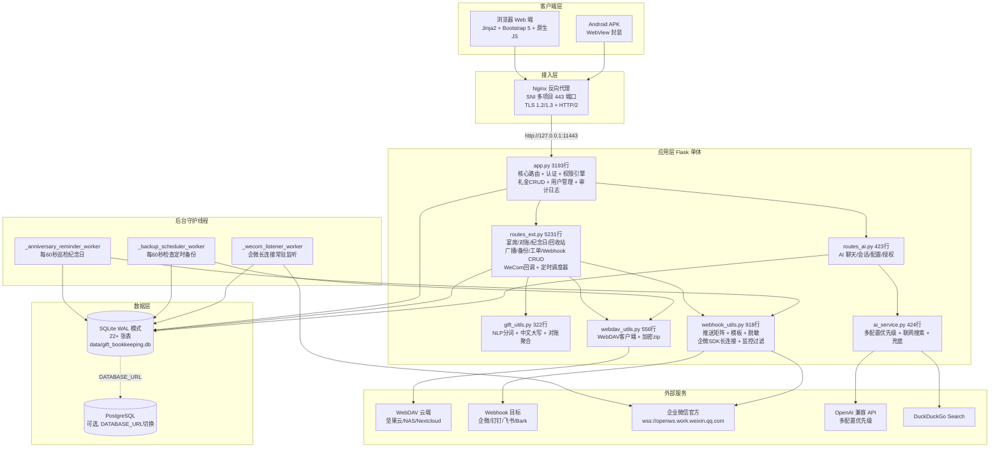
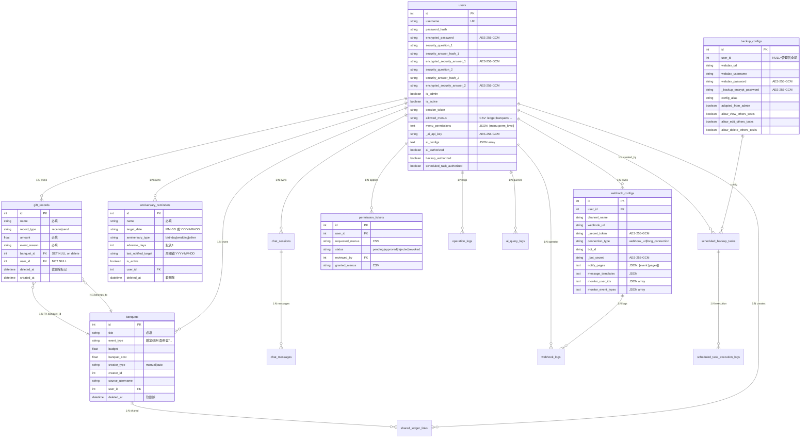
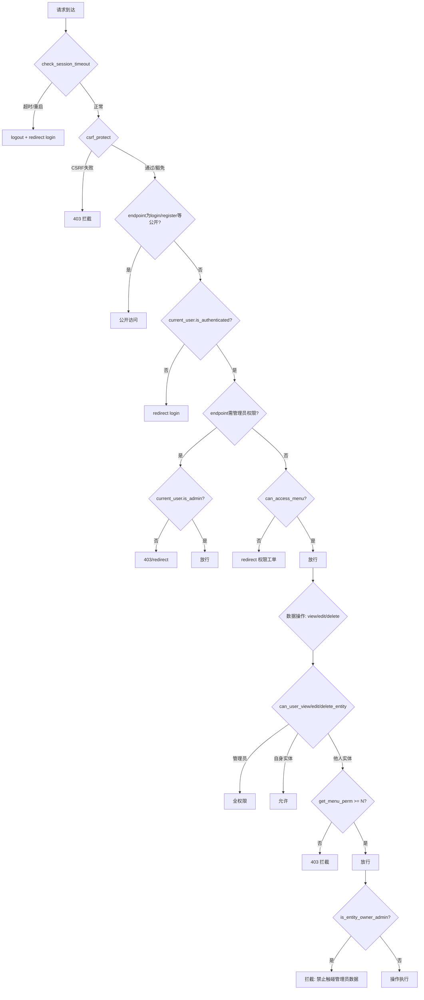
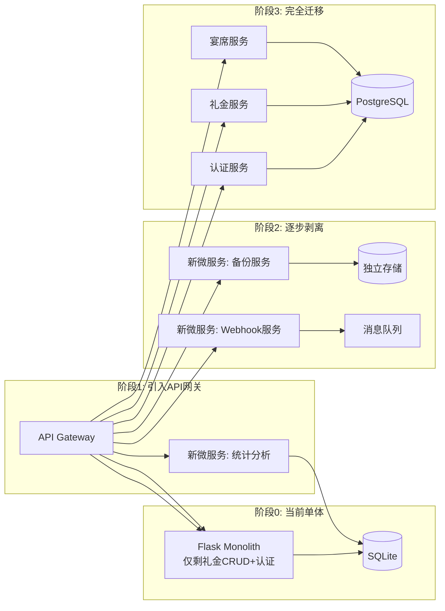

---
AIGC:
  ContentProducer: '001191110102MAD55U9H0F10002'
  ContentPropagator: '001191110102MAD55U9H0F10002'
  Label: '1'
  ProduceID: '1b232354-e410-498f-9bf7-470d56e411d1'
  PropagateID: '1b232354-e410-498f-9bf7-470d56e411d1'
  ReservedCode1: '9d894392-9c41-47c7-b912-2ac2560b67ef'
  ReservedCode2: '9d894392-9c41-47c7-b912-2ac2560b67ef'
---

# 人情礼金记账系统 PSD 设计与重构决策文档

> **版本**：V10.11.25  
> **生成日期**：2026-10-19   
> **项目根目录**：`C:\Users\cheng\Documents\akshare-test\gift_bookkeeping_app`  
> **审计基线**：代码 commit `f1e6744`（main 分支，filter-repo 重写后；原 6360bb6），README.md V10.10.10，Project_Survey.md ADR-01~38  
> **文档定位**：以代码为实现真相（Ground Truth），历史文档为设计意图真相，显式揭露漂移，证据链闭环。

---

## 目录

- [阶段 0：资产自发现与执行计划](#阶段-0资产自发现与执行计划)
- [第 1 部分：项目全局概览](#第-1-部分项目全局概览)
- [第 2 部分：文档-代码差异与漂移矩阵 (Drift Matrix)](#第-2-部分文档-代码差异与漂移矩阵-drift-matrix)
- [第 3 部分：架构模式识别](#第-3-部分架构模式识别)
- [第 4 部分：架构耦合度诊断](#第-4-部分架构耦合度诊断)
- [第 5 部分：架构替换与轻量化可行性决策](#第-5-部分架构替换与轻量化可行性决策)
- [第 6 部分：前后端详尽规格（校准整合版）](#第-6-部分前后端详尽规格校准整合版)
- [第 7 部分：数据持久化设计](#第-7-部分数据持久化设计)
- [第 8 部分：工程与安全保障](#第-8-部分工程与安全保障)
- [第 9 部分：综合问题排查与渐进演进路线图](#第-9-部分综合问题排查与渐进演进路线图)

---

## 阶段 0：资产自发现与执行计划

### 0.1 历史设计资产探测

递归检索项目内所有 `.md` 文档及含有架构/设计/规范关键字的文件，共发现 **4 份历史文档**：

| # | 文件路径 | 行数 | 预估用途 | 时效性判定 |
|---|---------|------|---------|-----------|
| 1 | `README.md` | 1042 | **用户手册 + 版本变更日志**（V2~V10.10.10，含功能说明、部署指南、样例数据、多仓库矩阵） | **新** — 最后更新 2026-09-22，版本迭代到 V10.10.10，与代码高度同步 |
| 2 | `Project_Survey.md` | 948+ | **系统架构设计规范 + ADR 决策记录**（ADR-01~ADR-38，含 6 大故障根因审计、业务模块设计规范、权限模型、Webhook/WebDAV/纪念日架构决策） | **新** — 最后更新 2026-09-22，ADR 追加到 38 条，是核心设计意图资产 |
| 3 | `AI_ASSISTANT_DESIGN.md` | 1932+ | **AI 助手模块技术设计 + 综合修复记录**（ER 图、API 规范、前端设计、V2~V10.7 逐版本修复详情） | **较新** — 最后更新约 V10.7（2026-09-17），后续 V10.8~V10.10.10 的修复记录仅在 README.md 中，未同步至此文档 |
| 4 | `V8_修复设计方案.md` | 240 | **V8 修复设计方案**（12 项需求的独立方案文档，已确认定稿） | **草稿/已归档** — 内容已被 AI_ASSISTANT_DESIGN.md 第十二章完整吸收，无独立参考价值 |

### 0.2 代码骨架与技术栈初判

#### 代码体量分布（行数为编辑器总行数口径，2026-09-23 实测）

| 文件 | 行数 | 占比 | 职责 |
|------|------|------|------|
| `routes_ext.py` | 5,231 | 40.3% | 业务扩展路由（最大单体文件） |
| `app.py` | 3,193 | 24.6% | Flask 核心 + 礼金 CRUD + 用户管理 |
| 21 个 HTML 模板 | 11,785 | — | 前端视图层（最大 1,527 行） |
| `models.py` | 1,071 | 8.2% | 22+ 张数据表模型定义 |
| `webhook_utils.py` | 918 | 7.1% | Webhook 推送引擎 |
| `webdav_utils.py` | 556 | 4.3% | WebDAV 客户端 |
| `run.sh` | 551 | 4.2% | 部署脚本 |
| `ai_service.py` | 424 | 3.3% | AI 核心服务 |
| `routes_ai.py` | 423 | 3.3% | AI 路由 |
| `gift_utils.py` | 322 | 2.5% | NLP 与对账工具 |
| 其他 | 302 | 2.3% | SSL 生成（152）、Web 搜索（81）、Nginx 配置（69） |
| **核心代码合计** | **12,991** | — | 不含模板；含模板共 24,776 行 |

#### 模板文件行数

| 文件 | 行数 |
|------|------|
| `admin_webhooks.html` | 1527 |
| `admin_users.html` | 1359 |
| `admin_backups.html` | 1249 |
| `index.html` | 1079 |
| `banquet_detail.html` | 994 |
| `reminders.html` | 862 |
| `banquets.html` | 648 |
| `ai_assistant.html` | 502 |
| `permission_tickets.html` | 461 |
| `admin_ai_config.html` | 450 |
| `base.html` | 493 |
| `recycle_bin.html` | 370 |
| `reconciliation.html` | 368 |
| `admin_logs.html` | 265 |
| `profile_security.html` | 262 |
| `admin_broadcasts.html` | 231 |
| `login.html` | 199 |
| `forgot_password.html` | 193 |
| `register.html` | 171 |
| `shared_ledger.html` | 261 |
| `change_password.html` | 52 |
| **合计** | **11,990** |

### 0.3 文档采纳决策

| 文档 | 采纳角色 | 理由 |
|------|---------|------|
| `Project_Survey.md` | **架构意图主源** | 38 条 ADR 是架构决策的权威记录，业务模块设计规范详尽 |
| `README.md` | **功能现状与版本演进主源** | 版本变更日志完整到 V10.10.10，功能清单与部署指南准确 |
| `AI_ASSISTANT_DESIGN.md` | **AI 模块与 V2~V10.7 修复细节参考** | ER 图、API 规范、前端设计详实，但需标注 V10.8+ 记录缺失 |
| `V8_修复设计方案.md` | **排除**（已被 AI_ASSISTANT_DESIGN.md 第十二章完整吸收） | 独立草稿，无增量信息 |

> **归档说明**（2026-09-23）：上表所列 Project_Survey.md、AI_ASSISTANT_DESIGN.md、V8_修复设计方案.md 三份历史文档，已在本 PSD 定稿后移入回收站归档。全文对其引用均记录审计时点状态，不影响本 PSD 的代码事实结论。

---

## 第 1 部分：项目全局概览

### 1.1 业务定位

人情礼金记账系统（Gift Bookkeeping App）是一套面向中国家庭/小团队的人情往来资产管理工具，核心解决三大痛点：
1. **礼金收支记账**：收礼/送礼双向记录，自然语言复合拆分一键入库
2. **人情对账追踪**：按亲友聚合收送差额，自动判定"待补礼/待还礼/已平账"
3. **多渠道预警推送**：企业微信/钉钉/飞书 Webhook + 企微官方长连接机器人，纪念日到期主动推送

系统具备多用户细粒度权限、WebDAV 加密云备份、AI 助手、权限工单审批等企业级能力，部署形态覆盖 Web 原生、Docker Compose 和 Android APK 三种交付。

### 1.2 真实技术栈全景清单

| 层级 | 技术选型 | 版本 | 代码依据 |
|------|---------|------|---------|
| **后端语言** | Python | 3.12（本地）/ 3.11-slim（Docker） | `run.sh:367` |
| **Web 框架** | Flask | 3.0.3 | `requirements.txt:1`、`app.py:42` |
| **ORM** | Flask-SQLAlchemy | 3.1.1 | `requirements.txt:2`、`models.py:75` |
| **认证** | Flask-Login (Session) | 0.6.3 | `requirements.txt:4`、`app.py:90-93` |
| **CSRF** | Flask-WTF | 1.2.1 | `requirements.txt:3`、`app.py:214-238` |
| **密码哈希** | Werkzeug | 3.0.3 | `requirements.txt:5`、`models.py:9` |
| **对称加密** | cryptography (AES-256-GCM) | 42.0.8 | `requirements.txt:7`、`models.py:10,27-43` |
| **数据库** | SQLite (WAL) / PostgreSQL (可选) | — | `app.py:68-78`，`DATABASE_URL` 环境变量切换 |
| **PostgreSQL 驱动** | psycopg2-binary + psycopg[binary]（V10.10.20 新增，SQLAlchemy 2.0 默认 psycopg3 驱动） | 2.9.9 / >=3.1 | `requirements.txt:8-9`（切换 PostgreSQL 的必要依赖；psycopg2-binary 供 webhook_utils 原生连接保留） |
| **WSGI 容器** | Gunicorn (已声明但**未实际使用**) | 22.0.0 | `requirements.txt:6`；`run.sh:167-174` 实际用 `python3 app.py` |
| **反向代理** | Nginx (SNI 多项目 443) | — | `config/nginx_ssl.conf`、`run.sh:224-291` |
| **前端** | Jinja2 + Bootstrap 5 + 原生 JS | — | `templates/base.html:23-25、256`（**V10.10.18 已本地化 `static/vendor/` 加载**） |
| **图表** | ECharts 5.5.0（V10.11 新增，本地化 `static/vendor/echarts/`） | 5.5.0 | `templates/dashboard.html`、`static/vendor/echarts/5.5.0/echarts.min.js` |
| **Excel 解析** | openpyxl（V10.11 新增） | >=3.1.0 | `requirements.txt:18`、`routes_ext.py` 导入路由 |
| **PDF 生成** | reportlab（V10.11 新增） | >=4.0.0 | `requirements.txt:19`、`pdf_generator.py` |
| **长图海报** | html2canvas（V10.11 新增，本地化 `static/vendor/html2canvas/`） | 1.4.1 | `templates/poster_template.html`、`static/vendor/html2canvas/1.4.1/html2canvas.min.js` |
| **PWA** | Service Worker | — | `static/sw.js`（1053 bytes） |
| **AI 接入** | OpenAI Python SDK | >=1.0.0 | `requirements.txt:14`、`ai_service.py` |
| **联网搜索** | DuckDuckGo Search | >=4.0.0 | `requirements.txt:15`、`web_search.py` |
| **企微机器人** | wecom-aibot-python-sdk | >=1.0.2 | `requirements.txt:11`、`aibot/` 目录 |
| **企微 SDK 运行依赖** | websockets + pyee | >=12.0 / >=11.0 | `requirements.txt:12-13`（长连接与事件循环） |
| **Webhook 网络** | requests + aiohttp | >=2.31.0 / >=3.9.0 | `requirements.txt:9-10`、`webhook_utils.py:18,47` |
| **加密备份** | pyzipper | >=0.3.1 | `requirements.txt:16`、`webdav_utils.py` |
| **部署脚本** | POSIX Shell (`#!/bin/sh`) | — | `run.sh:1`（551 行，兼容 dash/sh） |
| **SSL 证书** | 自签（cryptography 库生成） | — | `generate_ssl_certs.py` |

### 1.3 端到端架构拓扑图



---

## 第 2 部分：文档-代码差异与漂移矩阵 (Drift Matrix)

> 以下矩阵基于 `Project_Survey.md`（38 条 ADR）、`AI_ASSISTANT_DESIGN.md`、`README.md` 与实际代码的逐条交叉核验。

### 2.1 关键漂移项

| # | 模块/功能 | 历史文档记载 | 代码真实实现 | 状态 | 影响评估 |
|---|---------|------------|------------|------|---------|
| D-01 | **akshare 金融数据集成** | `Project_Survey.md` §3 详述 akshare 集成方案、熔断/降级/超时守卫规范；§1.1 定位含"金融量化/市场数据中台能力" | `requirements.txt` 无 akshare 依赖；全项目无 `import akshare`；`web_search.py` 仅用 DuckDuckGo | **未落地** | **低** — 业务上从未使用，文档描述与系统实际定位脱节，建议从文档中标注为"规划中/搁置" |
| D-02 | **Gunicorn 多 Worker 生产部署** | `Project_Survey.md` ADR-01 决策"全面采用 Gunicorn -w 4 -k gthread --threads 4"；`requirements.txt:6` 声明 gunicorn==22.0.0 | `run.sh:362-368` 实际启动命令为 `python3 $APP_SCRIPT`（Werkzeug 开发服务器），无 Gunicorn 调用 | **已废弃** | **高** — 开发服务器在生产环境存在并发瓶颈（Project_Survey.md §2 BUG-02 已诊断此问题），ADR-01 的解决方案未落地 |
| D-03 | **CDN 依赖彻底移除** | `Project_Survey.md` ADR-03 决策"彻底移除国外外部公共 CDN 链接，静态资源本地化" | ~~仍从 `cdn.jsdelivr.net`/`cdnjs.cloudflare.com` 加载~~ **✅ V10.10.18 已落地**：`static/vendor/` 本地化 14 个资源文件（Bootstrap 5.3.0/Font Awesome 6.4.0/Bootstrap Icons 1.11.3，版本与原 CDN 一致），`base.html` 4 处 + `shared_ledger.html` 2 处改为 `url_for` 本地引用 | **已落地** | **高→已清偿** — 内网/弱网白屏问题（BUG-04）随之解决 |
| D-04 | **Celery/Redis 任务队列** | `Project_Survey.md` ADR-04 决策"企业级方案引入 Redis + Celery 任务队列" | 代码使用 Python `threading.Thread` daemon 线程（`_anniversary_reminder_worker`、`_backup_scheduler_worker`、`_wecom_listener_worker`），无 Celery/Redis 依赖 | **方案降级** | **低** — 对当前单机部署规模合理，但文档应标注实际选型为轻量线程池方案 |
| D-05 | **权限级别 1 语义** | `Project_Survey.md` ADR-25 决策"级别 1 为全局绝对全只读模式，严禁修改或删除任何数据（包括自身创建的实体）" | V10.4 已修正为"自身全权 + 仅查看他人数据"（`app.py` `can_user_edit_entity` 自身实体可编辑，他人实体需 perm>=2）；`README.md` V10.4 记录了此变更但 ADR-25 未更新 | **已重构** | **中** — ADR-25 文档与代码语义矛盾，需更新 ADR 或新增 ADR 记录此次修正 |
| D-06 | **AI_ASSISTANT_DESIGN.md 版本覆盖** | 文档覆盖到 V10.7（2026-09-17），含 ER 图/API 规范/前端设计/逐版本修复 | V10.8~V10.10.10（约 20+ 条修复）仅在 `README.md` 变更日志中，未同步至本文档 | **版本断层** | **低** — 文档参考价值降低但不影响运行；新 PSD 应以 README.md 为最新事实源 |
| D-07 | **Service Worker 超时熔断** | `Project_Survey.md` BUG-06 决策"为 Service Worker fetch 增加超时限制与离线降级分支" | `static/sw.js` 仅 1053 bytes，无 `fetch` 事件拦截逻辑，无超时/降级代码 | **未落地** | **低** — 当前 SW 仅做 manifest 缓存壳，实际未拦截请求，反而避免了 BUG-06 描述的问题 |
| D-08 | **数据库连接超时** | `Project_Survey.md` ADR-02 决策 `connect_args={'timeout': 30}` | `app.py:83-84` 确实设置 `'timeout': 30`；`app.py:878-879` 设置 `PRAGMA busy_timeout=30000` | **一致** | — |
| D-09 | **AES-256-GCM 加密存储** | `Project_Survey.md` ADR-05/ADR-36 决策"敏感凭据 AES-256-GCM 加密落盘" | `models.py:27-43` `encrypt_credential`/`decrypt_credential` 实现 AESGCM；`WebhookConfig._secret_token`/`_bot_secret`、`BackupConfig._backup_encrypt_password`、`User._ai_api_key`、`SharedLedgerLink._access_password` 均密文存储 | **一致** | — |
| D-10 | **CSRF 全局保护** | `Project_Survey.md` ADR-05 决策"CSRF 强校验" | `app.py:214-238` 手动实现 CSRF token 生成与校验（非依赖 Flask-WTF 内置 decorator），企微回调/根路径/Webhook 接口免除 | **一致** | — |

### 2.2 漂移影响汇总

| 严重度 | 数量 | 漂移项 |
|--------|------|--------|
| **高影响** | 1 | D-02（Gunicorn 未落地）；D-03（CDN 未移除）✅ 已于 V10.10.18 清偿 |
| **中影响** | 1 | D-05（权限级别 1 语义矛盾） |
| **低影响** | 4 | D-01（akshare 未落地）、D-04（Celery 降级）、D-06（文档断层）、D-07（SW 未落地） |
| **一致** | 3 | D-08、D-09、D-10 |

---

## 第 3 部分：架构模式识别

### 3.1 模式判定：经典单体应用（Monolith）

**判定依据**：

| 维度 | 观察结论 | 代码依据 |
|------|---------|---------|
| **部署单元** | 单一 Python 进程，无微服务拆分 | `run.sh:362` `python3 $APP_SCRIPT` |
| **路由装配** | Flask 单 app 实例 + `register_routes_ext()` 注册扩展路由 + `routes_ai` 模块注册 AI 路由 | `app.py:33` `from routes_ext import register_routes_ext`；`routes_ext.py` 在函数内用 `@app.route` 注册 |
| **数据访问** | 全量 ORM（SQLAlchemy），无 Repository/DAO 抽象层；Model 直接在路由中 `query` | `app.py:960` `get_accessible_records_query(current_user)` 直接操作 Model |
| **通信模式** | 进程内同步调用，无 RPC/消息队列；异步任务用 daemon 线程 | `routes_ext.py:7` `import threading`；无 Celery/RabbitMQ/Kafka |
| **状态管理** | 服务端 Session（Flask-Login），无 JWT/Token 无状态设计 | `app.py:90-93` `LoginManager` |
| **前端渲染** | 服务端渲染（Jinja2 SSR），无 SPA/CSR 分离 | `templates/*.html` 21 个模板 |

### 3.2 分层结构（实际 vs 理想）

```
理想分层:                          实际分层:
┌─────────────────┐               ┌─────────────────────┐
│  Controller     │               │  Route Handler      │  ← 胖 Controller
│  (薄路由)        │               │  (路由+业务+数据访问  │     (app.py 3193行
├─────────────────┤               │   +权限校验+日志     │      routes_ext.py 5231行)
│  Service        │               │   +Webhook推送       │
│  (业务逻辑)     │  ← 缺失       ├─────────────────────┤
├─────────────────┤               │  Model              │
│  Repository     │  ← 缺失       │  (SQLAlchemy ORM     │
├─────────────────┤               │   +加解密property    │
│  Model          │               │   +权限方法)          │
└─────────────────┘               └─────────────────────┘
```

**关键发现**：系统**无 Service 层和 Repository 层**，业务逻辑直接内嵌在路由函数中。权限校验、Webhook 推送、审计日志、数据查询全部在同一个函数内完成，形成典型的**胖 Controller 反模式**。

### 3.3 模块间通信模式

| 通信类型 | 实现方式 | 代码依据 |
|---------|---------|---------|
| **同步 HTTP** | Flask 路由处理 → Jinja2 渲染 → 返回 HTML | 全部 `@app.route` |
| **AJAX 异步** | 前端 `fetch()` → 后端 `jsonify()` | `templates/base.html:233-259` 全局 Fetch 拦截器 |
| **后台线程** | `threading.Thread(daemon=True)` 三常驻线程 | `routes_ext.py` 三个 worker 函数 |
| **外部 HTTP** | `requests.Session()` 连接池 | `webhook_utils.py:47`、`webdav_utils.py` |
| **WebSocket 长连接** | `aibot.WSClient` 企微官方 SDK | `webhook_utils.py:29` `from aibot import WSClient` |
| **数据库直连** | SQLite 文件级 / PostgreSQL TCP | `app.py:80` `SQLALCHEMY_DATABASE_URI` |

---

## 第 4 部分：架构耦合度诊断

### 4.1 纯业务代码（框架无关，可直接复用）

| 模块 | 文件 | 行数 | 复用评估 |
|------|------|------|---------|
| NLP 分词引擎 | `gift_utils.py:58-86` `split_gift_nlp_text` | ~30 | 纯 Python 正则，零框架依赖，**可直接复用** |
| 中文大写数字转换 | `gift_utils.py:13-55` `cn2num` | ~43 | 纯算法，零依赖，**可直接复用** |
| 对账聚合计算 | `gift_utils.py` `calculate_reconciliation` | ~50 | 纯数据计算逻辑，**可直接复用** |
| AES-256-GCM 加解密 | `models.py:14-73` `encrypt_credential`/`decrypt_credential` | ~60 | 仅依赖 `cryptography` 库，**可直接复用** |
| CSV 导出逻辑 | `app.py:2961-2998` `export_csv` 核心 | ~40 | CSV 格式化逻辑可复用，路由绑定需剥离 |
| Cron 表达式解析 | `routes_ext.py` `_cron_match` | ~40 | 纯算法，**可直接复用** |

**纯业务代码占比估计：约 15-20%**（~2,200 行）

### 4.2 强侵入代码（强依赖框架 API，替换必须重写）

| 模块 | 文件 | 行数 | 耦合点 |
|------|------|------|--------|
| **全部路由处理** | `app.py` + `routes_ext.py` + `routes_ai.py` | ~7,942 | `@app.route`、`request`/`flash`/`redirect`/`url_for`/`jsonify`、`render_template` |
| **认证中间件** | `app.py:155-261` | ~107 | `@app.before_request`、`current_user`、`login_user`/`logout_user`、`session` |
| **CSRF 保护** | `app.py:214-238` | ~25 | Flask `request.form`/`session`/`abort` |
| **模板渲染** | 21 个 HTML 模板 | 11,785 | Jinja2 模板语法 ``、`{{ }}`、`url_for()` |
| **ORM 模型** | `models.py` 全量 | 1,071 | `db.Model`、`db.Column`、`db.relationship`、`db.session` |
| **Webhook 推送引擎** | `webhook_utils.py` | 918 | `trigger_webhook_event` 直接操作 `WebhookConfig.query` |
| **权限引擎** | `app.py` `can_user_*` 系列 + `models.py` `get_menu_perm` | ~200 | 与 Flask `current_user`、SQLAlchemy `query` 深度耦合 |

**强侵入代码占比估计：约 80-85%**

### 4.3 分层退化坏味道

#### 坏味道 1：胖 Controller — 路由函数承载全部逻辑

**典型代码**：`routes_ext.py` `admin_upload_local_backup` 路由（~130 行）

```
路由函数内完成：
  ① 文件上传校验 → ② 文件命名/归属校验 → ③ 数据库完整性检查 →
  ④ 权限判定（管理员/普通用户分流）→ ⑤ 文件级替换 或 数据级合并 →
  ⑥ ATTACH DATABASE 跨库操作 → ⑦ init_database 迁移 →
  ⑧ Webhook 推送 → ⑨ 审计日志 → ⑩ Flash 提示 + 重定向
```

**影响**：单个函数职责超过 10 个，任何修改都有高回归风险。

#### 坏味道 2：SQL 外露 — ORM 之外直接执行原生 SQL

**典型代码**：`routes_ext.py:47-105` `build_user_scoped_backup_db`

```python
# 直接 sqlite3.connect 而非 SQLAlchemy
_src_conn = _sqlite3.connect(db_path)
_dst_conn = _sqlite3.connect(tmp_db)
with _dst_conn:
    _src_conn.backup(_dst_conn)
# 直接执行 DELETE/DROP TABLE
c.execute("DELETE FROM gift_records WHERE user_id != ?", (user.id,))
c.execute(f'DROP TABLE IF EXISTS "{tbl}"')
```

**影响**：绕过 ORM 的事务管理和连接池，存在数据库状态不一致风险。

#### 坏味道 3：数据库迁移硬编码 SQL — 无版本管理

**典型代码**：`app.py:681-817` `init_database` migration_sqls

```python
migration_sqls.extend([
    "ALTER TABLE backup_configs ADD COLUMN config_alias VARCHAR(100)",
    "ALTER TABLE backup_configs ADD COLUMN adopted_from_admin BOOLEAN DEFAULT 0",
    ...
])
# 逐条 try-except 忽略错误
for sql in migration_sqls:
    try:
        conn.execute(db.text(sql))
        conn.commit()
    except Exception:
        pass  # 已存在则跳过
```

**影响**：无 Alembic/Flask-Migrate 版本管理，迁移失败被静默吞没，无法回滚。

#### 坏味道 4：路由文件膨胀失控

| 文件 | 行数 | 路由数量（估计） | 单文件职责 |
|------|------|---------------|---------|
| `routes_ext.py` | 5,231 | ~82 个路由 | 宴席/对账/纪念日/回收站/广播/备份/工单/Webhook/WeCom/定时任务 |
| `app.py` | 3,193 | ~37 个路由 | 礼金CRUD/认证/用户管理/审计日志/安全配置/导出导入 |

**影响**：单文件 5231 行已超出可维护阈值，模块边界模糊。

#### 坏味道 5：前端逻辑内联 — JS 与 HTML 混杂

`admin_webhooks.html`（1527 行）中包含大量内联 `<script>`，矩阵配置/事件绑定/AJAX 逻辑全部嵌在 HTML 中，无独立 JS 模块。

---

## 第 5 部分：架构替换与轻量化可行性决策

### 5.1 评估动机

| 评估维度 | 当前状态 | 是否存在瓶颈 |
|---------|---------|------------|
| **框架重量** | Flask 3.0 轻量级，无过度抽象 | **否** — Flask 本身足够轻量，非瓶颈 |
| **并发性能** | Werkzeug 开发服务器单线程 | **是** — 生产部署仍用 `python3 app.py`，无多 Worker（D-02 漂移） |
| **代码可维护性** | 5231 行单文件，无 Service 层 | **是** — 胖 Controller 已导致修改回归风险高 |
| **前端体验** | Jinja2 SSR + 本地静态资源 + 内联 JS | **否** — V10.10.18 前端资源已本地化（D-03 已清偿），SSR 满足业务需求 |
| **数据库扩展** | SQLite WAL 足够单机场景 | **否** — 已支持 PostgreSQL 无缝切换 |
| **部署复杂度** | 单文件部署 + run.sh 自动化 | **否** — 部署体验优秀 |

**核心结论**：框架本身不是瓶颈，**工程纪律缺失**（无 Service 层、无迁移版本管理、CDN 未本地化、Gunicorn 未启用）才是真正的问题。

### 5.2 替换代价 vs 收益矩阵

| 方案 | 代价 | 收益 | ROI |
|------|------|------|-----|
| **A. 维持 Flask + 局部治理** | 低（重构内部结构，不换框架） | 中（可维护性提升，并发修复） | **高** |
| **B. 换 FastAPI + 前后端分离** | 极高（全部路由+模板+认证重写，~14,000 行） | 高（异步原生支持、自动文档、类型安全） | **低** |
| **C. 换 Django + DRF** | 极高（ORM 迁移、模板迁移、认证迁移） | 中（admin 内置、migrate 内置） | **低** |
| **D. 换 Go/Rust 重写** | 灾难级（全量重写） | 高（性能极大提升） | **极低** |

### 5.3 模块可替换性资产分级表

| Level | 定义 | 模块 | 估计行数 |
|-------|------|------|---------|
| **Level 1** | 纯业务复用（零框架依赖，可直接搬运） | `cn2num`、`split_gift_nlp_text`、`calculate_reconciliation`、`encrypt_credential`/`decrypt_credential`、`_cron_match` | ~2,200 |
| **Level 2** | 轻度适配可复用（改 import 和接口签名即可） | `webdav_utils.py`（WebDAV 协议无关）、`ai_service.py`（OpenAI SDK 无框架绑定）、`web_search.py`、`gift_utils.py` 的 `parse_gift_nlp` | ~1,000 |
| **Level 3** | 强框架耦合，替换需大幅重写 | 全部 `@app.route` 路由（~7,942 行）、`models.py`（SQLAlchemy 模型）、`webhook_utils.py`（依赖 `WebhookConfig.query`）、权限引擎、CSRF 中间件 | ~9,500 |
| **Level 4** | 架构级推倒重写 | 21 个 Jinja2 模板（11,785 行）— 换前端框架必须全量重写 | ~11,785 |

### 5.4 最终结论

> **【不建议替换，仅局部治理】**

**理由**：

1. **Flask 本身不是瓶颈**。系统并发问题的根因是未启用 Gunicorn（D-02 漂移），而非框架选型。启用 Gunicorn 多 Worker 即可解决，代价仅修改 `run.sh` 一行启动命令。

2. **替换 ROI 极低**。Level 3+4 代码占总量 80%+（~20,400 行），任何框架替换都意味着近乎全量重写，而当前系统功能完整、业务运行正常，重写收益无法覆盖代价。

3. **真正需要的是工程纪律**。当前技术债来自"有决策未执行"（Gunicorn；CDN 本地化已于 V10.10.18 执行）和"无规范的开发模式"（无 Service 层、无迁移版本管理），而非框架能力不足。

**推荐治理清单（P0 立即执行）**：

| 优先级 | 治理项 | 漂移编号 | 预估工作量 | 具体操作 |
|--------|--------|---------|-----------|---------|
| **P0** | 启用 Gunicorn 多 Worker | D-02 | 0.5 人日 | `run.sh` 启动命令从 `python3 app.py` 改为 `gunicorn -w 4 -k gthread --threads 4 -b 127.0.0.1:$PORT app:app --timeout 60` |
| **P0** | ~~CDN 资源本地化~~ **✅ V10.10.18 已完成** | D-03 | — | Bootstrap 5.3.0/Font Awesome 6.4.0/Bootstrap Icons 1.11.3 共 14 个文件已落地 `static/vendor/`，`base.html` 4 处 + `shared_ledger.html` 2 处改本地引用 |
| **P1** | 更新 ADR-25 权限语义 | D-05 | 0.5 人日 | 在 `Project_Survey.md` 中追加 ADR-39 记录 V10.4 权限级别 1 语义修正 |
| **P1** | 标注 akshare 为"规划搁置" | D-01 | 0.5 人日 | 在 `Project_Survey.md` §3 添加状态标注 |
| **P2** | routes_ext.py 拆分 | — | 3 人日 | 按业务域拆分为 `routes_banquets.py`/`routes_backups.py`/`routes_webhooks.py` 等 |
| **P2** | 引入 Flask-Migrate | — | 2 人日 | 替换 `init_database` 硬编码 SQL 为 Alembic 版本管理 |
| **P2** | 提取 Service 层 | — | 5 人日 | 将路由中的业务逻辑抽离为 `services/` 模块，路由仅负责参数校验和响应 |

---

## 第 6 部分：前后端详尽规格（校准整合版）

### 6.1 前端架构

#### 6.1.1 技术栈与渲染模式

| 维度 | 实现 | 代码依据 |
|------|------|---------|
| 渲染模式 | 服务端渲染（SSR），Jinja2 模板继承 | `templates/base.html` 为布局模板，各页面 `` |
| CSS 框架 | Bootstrap 5.3.0（本地 `static/vendor/bootstrap/5.3.0/`，V10.10.18 起替代 CDN） | `base.html:23、256` |
| 图标库 | Font Awesome 6.4.0 + Bootstrap Icons 1.11.3（本地 `static/vendor/`，V10.10.18 起替代 CDN） | `base.html:24-25` |
| 图表库 | 无（历史文档记载 Chart.js，实际模板内已无引用） | — |
| JavaScript | 原生 JS（无框架、无构建工具），`fetch()` API 做 AJAX 通信 | 全部模板内联 `<script>` |
| PWA | `static/manifest.json` + `static/sw.js`（仅 manifest 壳，无 fetch 拦截） | `base.html:9-10` |
| CSRF | 全局 `<meta name="csrf-token">` 注入，fetch 请求头携带 `X-CSRF-Token` | `base.html:6、396-400、418` |
| 主题系统 | Bootstrap 5.3 原生 `data-bs-theme` 双主题（白天/黑夜），CSS 变量（`--app-bg`/`--app-card-bg` 等 6 个）驱动；导航栏主题切换按钮 + `localStorage('gift_theme')` 持久化，默认白天零回归；暗色下统一覆盖 `bg-white/bg-light/text-dark/text-muted/table-light` 等浅色工具类 | `base.html` 全局 `<style>`、`V10.10.13` 新增 |
| 输入框提示语 | 全局 `::placeholder` 统一美化（浅灰蓝 `--ph-color`、常规字重 400、0.875em、半透明、聚焦淡出），覆盖全部 20 个含输入框页面约 122 处 | `base.html` 全局 `<style>`、`V10.10.13` 新增 |

#### 6.1.2 路由（前端导航）

前端无 SPA 路由，全部通过 Flask `url_for()` 生成后端路由链接，浏览器整页跳转。AJAX 请求仅用于局部刷新（如 WebDAV 列表异步加载、Webhook 测试 toast、权限配置即时保存等）。

**全局导航栏**（`base.html:56-80`）基于 `current_user.can_access_menu(menu_key)` 动态渲染：

| 菜单项 | menu_key | 可见条件 |
|--------|---------|---------|
| 礼金账本 | `ledger` | 管理员或 `can_access_menu('ledger')` |
| 专属宴席 | `banquets` | 管理员或 `can_access_menu('banquets')` |
| 人情对账 | `reconciliation` | 管理员或 `can_access_menu('reconciliation')` |
| 纪念日备忘 | `reminders` | 管理员或 `can_access_menu('reminders')` |
| 回收站 | `recycle_bin` | 管理员或 `can_access_menu('recycle_bin')` |

#### 6.1.3 前端全局 Fetch 拦截器

`base.html:233-259` 定义全局 fetch 响应拦截逻辑：
- HTTP 401 + JSON 含 `need_verify` 字段 → 豁免跳转（V10.7 修复凭证验证误跳转）
- HTTP 401（非 need_verify）→ 判定登录失效，`alert()` + `window.location.href = '/login'`
- 其余响应透传

#### 6.1.4 模板清单与职责

| 模板 | 行数 | 核心职责 |
|------|------|---------|
| `base.html` | 398 | 全局布局、导航栏、Flash 提示、全局 JS/CSS 引入 |
| `index.html` | 1079 | 礼金账本首页：列表/搜索/分页/统计/新增编辑模态框/NLP 录入/CSV 导入导出 |
| `admin_webhooks.html` | 2015 | Webhook 管理：通道配置与机器人/系统告警消息推送（双Tab）/操作授权/推送日志 |
| `admin_users.html` | 1509 | 用户管理：列表/权限配置模态框/AI+备份+Webhook授权/凭证查看/重置密码+密保 |
| `admin_backups.html` | 1253 | WebDAV 备份：配置/定时任务/云端备份列表/本地备份/附件恢复/定时调度 |
| `banquet_detail.html` | 994 | 宴席明细：现场收礼/分页/搜索/批量操作/分享链接 |
| `reminders.html` | 862 | 纪念日备忘：列表/搜索/批量推送模态框/多通道选择/定时调度 |
| `banquets.html` | 648 | 宴席总览：卡片/表格双视图/搜索/批量删除 |

### 6.2 后端核心服务分层

#### 6.2.1 路由装配机制

```
app.py (Flask app 实例创建)
  ├── @app.route 核心路由 (37 个) → 直接定义在 app.py
  ├── register_routes_ext(app) → 从 routes_ext.py 注册扩展路由 (82 个)
  └── register_ai_routes(app, log_action) → 从 routes_ai.py 注册 AI 路由 (14 个)
```

**代码依据**：`app.py:33` `from routes_ext import register_routes_ext`；`routes_ai.py:17` `def register_ai_routes(app, log_action=None)`

#### 6.2.2 中间件流水线（`@app.before_request` 执行顺序）

| 顺序 | 函数 | 文件位置 | 职责 |
|------|------|---------|------|
| 1 | `check_session_timeout` | `app.py:155` | 会话超时检测 + 服务重启强制重新登录（`APP_START_TIME` 比对） |
| 2 | `csrf_protect` | `app.py:214` | CSRF Token 生成与校验（企微回调/根路径/Webhook 接口免除） |
| 3 | `handle_wecom_root_callback` | `app.py:240` | 企微回调请求打到根路径 `/` 时自动分发 |

| 顺序 | 函数 | 文件位置 | 职责 |
|------|------|---------|------|
| 后置 | `add_header` | `app.py:207` | 全局 `Cache-Control: no-cache, no-store` |

#### 6.2.3 权限引擎核心函数

| 函数 | 位置 | 职责 |
|------|------|------|
| `get_accessible_records_query(user, menu_key)` | `app.py:465` | 按菜单权限返回可见记录的 Query 对象 |
| `can_user_view_entity(user, entity, menu_key)` | `app.py:501` | 判断查看权限（自身→True；他人→perm>=1） |
| `can_user_edit_entity(user, entity, menu_key)` | `app.py:516` | 判断修改权限（自身→True；他人→perm>=2；管理员实体→False） |
| `can_user_delete_entity(user, entity, menu_key)` | `app.py:532` | 判断删除权限（自身→perm!=2；他人→perm>=3；管理员实体→False） |
| `is_entity_owner_admin(entity)` | `app.py:479` | 判断实体创建者是否为管理员（防越权红线） |

#### 6.2.4 后台异步任务

| 守护线程 | 位置 | 轮询周期 | 职责 |
|---------|------|---------|------|
| `_anniversary_reminder_worker` | `routes_ext.py:380` | 60 秒 | 巡检到达预警天数的纪念日，自动推送 Webhook（周期锁防重 `last_notified_target`） |
| `_backup_scheduler_worker` | `routes_ext.py:499` | 60 秒 | 检查 `ScheduledBackupTask` 表中启用任务，按 cron 表达式执行加密备份 |
| `_wecom_listener_worker` | `webhook_utils.py` | 常驻 | 企微 WebSocket 长连接监听，自动捕获群聊 `chatid`（V10.10.14 修正写库路径；V10.10.15 修正 `bot_secret` AES-256-GCM 密文解密——raw SQL 读取的是密文，需 `decrypt_credential()` 解密后传给 SDK 认证；真实企微群 @机器人 实测通过，全链路闭环确认） |

### 6.3 核心 API 规范清单（10 个核心接口）

#### API-01: 用户登录

| 属性 | 值 |
|------|-----|
| 路径 | `POST /login` |
| 鉴权 | 公开（未登录） |
| 校验 | 用户名+密码；连续失败>=5 次触发验证码+锁定；管理员额外校验密保 |
| 代码 | `app.py:1190-1305` |
| 成功 | redirect → `index`，session 注入 `session_token` + `login_time` |
| 失败 | HTTP 200 + flash 消息（非 JSON），渲染 `login.html` |
| 风控 | `LoginRisk` 表 + 内存字典双重计数；锁定时长由 `SystemSetting.login_lockout_seconds` 控制 |

#### API-02: 新增礼金记录

| 属性 | 值 |
|------|-----|
| 路径 | `POST /record/add` |
| 鉴权 | `@login_required` |
| 校验 | name 必填、amount 必填（支持中文大写 `cn2num` 转换）、event_reason 必填 |
| 代码 | `app.py:1605-1695` |
| 权限 | 级别 0~3 均可新增自身记录（V10.4 移除级别 1 拦截） |
| 成功 | AJAX → `{"code":200, "record_id": N}`；表单 → flash + redirect |
| Webhook | `trigger_webhook_event` → `record_create` / `ledger` |
| 审计 | `log_action('新增记录', ...)` |

#### API-03: NLP 复合录入

| 属性 | 值 |
|------|-----|
| 路径 | `POST /api/record/nlp_quick_add` |
| 鉴权 | `@login_required` |
| 校验 | 文本非空；`split_gift_nlp_text()` 分词 + `parse_gift_nlp_multi()` 解析 |
| 代码 | `routes_ext.py` 内定义 |
| 成功 | `{"code":200, "data":{"created_count":N, "records":[...]}}` |
| 特性 | 支持顿号/分号/换行/竖线/连词分割，原子级多笔提交 |

#### API-04: CSV 导出

| 属性 | 值 |
|------|-----|
| 路径 | `GET /export/csv` |
| 鉴权 | `@login_required` |
| 参数 | `scope` (all/filtered/page)、`ids`、`search`、`reason`、`type`、`sort`、`page`、`per_page` |
| 代码 | `app.py:2887-2998` |
| 输出 | CSV（UTF-8 BOM），列：ID/姓名/往来类型/年龄/电话/金额/大写金额/事由/宴席/地址/备注/时间/录入人 |
| Webhook | `security` / `ledger` |

#### API-05: 纪念日手动推送

| 属性 | 值 |
|------|-----|
| 路径 | `POST /api/reminders/custom_push` |
| 鉴权 | `@login_required` + `can_access_menu('reminders')` + `get_menu_perm('reminders') != 1` |
| 参数 | `reminder_ids`（多选）、`webhook_ids`（多通道）、`repeat_count`(1~5)、`interval_seconds`(0~300)、`custom_content` |
| 代码 | `routes_ext.py` |
| 特性 | 异步线程多轮推送；每轮记录 WebhookLog；权限级别 1（只读）拦截 |

#### API-06: AI 聊天

| 属性 | 值 |
|------|-----|
| 路径 | `POST /api/ai/chat` |
| 鉴权 | `@login_required` + `can_use_ai()` |
| 参数 | `{"query": "...", "session_id": 123}` |
| 代码 | `routes_ai.py:61-90` |
| 响应 | `{"code":200, "data":{"query":"...", "response":"...", "used_openai":true, "used_config_name":"...", "used_search":false, "latency_ms":500, "session_id":123, "session_title":"..."}}` |
| 配置优先级 | 用户多配置 → 旧版单配置 → 环境变量 → 管理员共享 → 本地兜底 |

#### API-07: WebDAV 备份触发

| 属性 | 值 |
|------|-----|
| 路径 | `POST /admin/backups/trigger` |
| 鉴权 | `@login_required` + `can_use_backup()` |
| 代码 | `routes_ext.py` |
| 特性 | 管理员→完整库文件级备份；普通用户→`build_user_scoped_backup_db()` 过滤库（DROP 19 张全局表） |
| 加密 | 可选 AES-256 加密 zip（`pyzipper`） |

#### API-08: 备份恢复

| 属性 | 值 |
|------|-----|
| 路径 | `POST /admin/backup/upload_local` + `POST /admin/backup/restore`（代码注册别名：`/admin/backups/restore`、`/admin/backups/restore/<path:filename>`，`routes_ext.py:4221-4223`） |
| 鉴权 | `@login_required` + `can_use_backup()` |
| 代码 | `routes_ext.py` `admin_upload_local_backup` / `admin_restore_webdav_backup` |
| 管理员路径 | `sqlite3.backup()` 原子替换 + WAL/SHM 清理 + `init_database()` 迁移 |
| 普通用户路径 | `merge_user_scoped_backup()` 数据级合并（ATTACH DATABASE 跨库，仅本人三张业务表） |
| 安全 | 文件命名校验 + 归属校验 + 完整库拦截 + `PRAGMA integrity_check` |

#### API-09: 管理员查看用户凭证

| 属性 | 值 |
|------|-----|
| 路径 | `GET/POST /admin/user/<int:user_id>/credentials` |
| 鉴权 | 管理员专属 + 管理员目标需二次验证 |
| 代码 | `app.py:2743-2802` |
| 特性 | 管理员查看管理员凭证需验证原密码或密保；HTTP 200 + JSON `code:401` + `need_verify:true`（V10.7 修复避免全局拦截器误判） |

#### API-10: 权限工单审批

| 属性 | 值 |
|------|-----|
| 路径 | `POST /permission_tickets/<int:ticket_id>/approve` |
| 鉴权 | 管理员专属 |
| 代码 | `routes_ext.py:4977-5034` |
| 逻辑 | 工单 status → approved；勾选的菜单合并到 `user.allowed_menus`；Webhook 推送 + 审计日志 |

---

## 第 7 部分：数据持久化设计

### 7.1 核心实体关系（ER 图）



### 7.2 完整数据表清单（26 张表，V10.11.14 校准）

| # | 表名 | ORM 模型 | 行数估计 | 核心用途 |
|---|------|---------|---------|---------|
| 1 | `users` | `User` | ~10 | 用户账号、权限、AI/备份授权、密保 |
| 2 | `gift_records` | `GiftRecord` | ~150 | 礼金收送记录（核心业务表） |
| 3 | `banquets` | `Banquet` | ~4 | 专属宴席大账本 |
| 4 | `anniversary_reminders` | `AnniversaryReminder` | ~6 | 纪念日提醒 |
| 5 | `operation_logs` | `OperationLog` | ~300 | 操作审计日志 |
| 6 | `system_settings` | `SystemSetting` | ~10 | 系统配置键值对 |
| 7 | `registration_tokens` | `RegistrationToken` | ~5 | 邀请注册令牌 |
| 8 | `login_risks` | `LoginRisk` | ~5 | 登录失败计数与锁定 |
| 9 | `security_risks` | `SecurityRisk` | ~5 | 密保验证失败计数 |
| 10 | `broadcasts` | `Broadcast` | ~2 | 系统广播 |
| 11 | `broadcast_reads` | `BroadcastRead` | ~10 | 广播已读记录 |
| 12 | `webhook_configs` | `WebhookConfig` | ~3 | Webhook 通道配置 |
| 13 | `webhook_logs` | `WebhookLog` | ~50 | Webhook 推送日志 |
| 14 | `shared_ledger_links` | `SharedLedgerLink` | ~2 | 宴席只读分享外链 |
| 15 | `backup_configs` | `BackupConfig` | ~2 | WebDAV 备份配置 |
| 16 | `scheduled_backup_tasks` | `ScheduledBackupTask` | ~2 | 定时备份任务 |
| 17 | `scheduled_task_execution_logs` | `ScheduledTaskExecutionLog` | ~10 | 定时任务执行历史 |
| 18 | `backup_attachments` | `BackupAttachment` | ~0 | 备份附件 |
| 19 | `permission_tickets` | `PermissionTicket` | ~3 | 权限申请工单 |
| 20 | `chat_sessions` | `ChatSession` | ~5 | AI 聊天会话 |
| 21 | `chat_messages` | `ChatMessage` | ~20 | AI 聊天消息 |
| 22 | `ai_query_logs` | `AIQueryLog` | ~10 | AI 查询日志 |
| 23 | `family_groups` | `FamilyGroup` | ~2 | 家庭记账共管组（组长/名称/描述） |
| 24 | `family_members` | `FamilyMember` | ~5 | 家庭组成员角色（admin/member/viewer） |
| 25 | `alert_push_configs` | `AlertPushConfig` | ~1 | 系统告警推送规则与静默期配置 |
| 26 | `alert_push_grants` | `AlertPushGrant` | ~5 | 告警操作细粒度授权（edit/test/view_log） |

### 7.3 字段约束与安全机制

| 机制 | 实现 | 代码依据 |
|------|------|---------|
| 密码存储 | Werkzeug `generate_password_hash`（单向） + AES-256-GCM `encrypted_password`（可逆） | `models.py:128-130` |
| 密保存储 | 双密保：`security_answer_hash_1/2`（单向哈希） + `encrypted_security_answer_1/2`（AES-256-GCM 可逆） | `models.py:215-231` |
| 敏感凭证加密 | `secret_token`、`bot_secret`、`webdav_password`、`backup_encrypt_password`、`access_password`、`ai_api_key` 全部 AES-256-GCM 密文 | `models.py:781-906` |
| 软删除 | `gift_records`、`banquets`、`anniversary_reminders` 含 `deleted_at` 字段 | `models.py:498,460,539` |
| 外键级联 | `ondelete='CASCADE'`：ChatSession→ChatMessage、User→GiftRecord/Banquet/Reminder；`ondelete='SET NULL'`：GiftRecord→Banquet | `models.py:408,466,501` |
| UNIQUE 约束 | `users.username`（唯一） | `models.py:81` |
| 非空约束 | `GiftRecord.name`、`amount`、`event_reason`、`user_id` 非空 | `models.py:489,494,495,501` |

### 7.4 索引有效性评估

| 表 | 显式索引 | 代码依据 | 有效性评估 |
|------|---------|---------|-----------|
| `users` | `username` UNIQUE → 自动索引 | `models.py:81` | **有效** — 登录查询按 username |
| `gift_records` | 无显式索引 | — | **缺失** — `user_id`、`event_reason`、`deleted_at` 高频查询无索引，150 条数据量下暂无性能问题 |
| `webhook_configs` | 无显式索引 | — | `user_id` 查询无索引，数据量小可忽略 |
| `operation_logs` | 无显式索引 | — | **潜在风险** — `created_at` 排序+清理按时间范围扫描，日志量增长后可能变慢 |

**结论**：当前数据量极小（样例 151 条礼金记录），无索引性能瓶颈。但 `operation_logs` 随时间累积（90 天自动清理）后在百级数据量下仍可接受。若迁移 PostgreSQL 建议补充 `user_id`、`deleted_at` 索引。

### 7.5 事务机制

| 场景 | 事务实现 | 代码依据 |
|------|---------|---------|
| 常规 CRUD | SQLAlchemy `db.session.commit()` 自动事务 | 全部路由 |
| 备份合并 | 原生 sqlite3 `ATTACH DATABASE` → `commit` → `DETACH`（顺序敏感） | `routes_ext.py:162-200` |
| 数据库恢复 | `sqlite3.backup()` 原子操作 + WAL/SHM 清理 | `routes_ext.py` 恢复路由 |
| 日志写入 | `try-except` 包裹，日志失败不回滚主业务事务 | `app.py:406-408` |
| WAL 模式 | `PRAGMA journal_mode=WAL` + `PRAGMA busy_timeout=30000` | `app.py:876-879` |

### 7.6 数据库迁移机制

**现状**：无 Alembic/Flask-Migrate 版本管理。`init_database()` 函数（`app.py:653-939`）在应用启动时自动执行：

1. **orphan index 修复**（V5）：`PRAGMA writable_schema=1` 查找并删除孤儿索引
2. `db.create_all()`：创建缺失表
3. **migration_sqls 列表**：约 60 条 `ALTER TABLE ADD COLUMN` 语句，逐条 `try-except` 忽略已存在错误
4. **V10.9 数据迁移**：将空 Webhook 监控范围预填为全选
5. **WAL 模式开启** + **风控状态重置** + **管理员账号同步**

**风险**：迁移失败被静默吞没（`except Exception: pass`），无回滚能力，无版本追踪。

---

## 第 8 部分：工程与安全保障

### 8.1 环境变量与配置分离

| 环境变量 | 默认值 | 用途 | 代码依据 |
|---------|--------|------|---------|
| `PORT` | `11443` | Flask 后端监听端口 | `run.sh:31`、`app.py` `__main__` |
| `NGINX_PORT` | `443` | Nginx 对外监听端口 | `run.sh:32` |
| `ADMIN_USER` | `admin` | 管理员用户名 | `run.sh:33`、`app.py:901` |
| `ADMIN_PASS` | `admin123` | 管理员初始密码 | `run.sh:34`、`app.py:902` |
| `DATABASE_URL` | (空) | PostgreSQL 连接串（空则降级 SQLite） | `app.py:76-78` |
| `SECRET_KEY` | 硬编码默认值 | Flask 会话密钥 | `app.py:43` |
| `SESSION_COOKIE_SECURE` | `false` | HTTPS Cookie 传输 | `app.py:53` |
| `OPENAI_API_KEY` | (空) | 全局 AI 配置（第3优先级） | `ai_service.py:90` |
| `OPENAI_BASE_URL` | (空) | 全局 AI Base URL | `ai_service.py:95` |
| `OPENAI_MODEL` | `gpt-4o-mini` | 全局 AI Model | `ai_service.py:96` |
| `PROJECT_NAME` | `gift_app` | Nginx 配置文件名/upstream 名 | `run.sh:14` |
| `SNI_DOMAIN` | `localhost` | SNI 域名（证书 CN/SAN） | `run.sh:15` |
| `SNI_DEFAULT_SERVER` | `1` | 是否作为 443 兜底 default_server | `run.sh:18` |
| `SSL_CERT`/`SSL_KEY` | `$APP_DIR/ssl/*` | SSL 证书路径（可指向正式证书） | `run.sh:16-17` |
| `SSL_FORCE_UPDATE` | (空) | 强制更新 SSL 证书 | `run.sh:27` |
| `NGINX_CONF_FORCE_UPDATE` | (空) | 强制覆盖 Nginx 配置 | `run.sh:28` |

### 8.2 认证与鉴权模型



### 8.3 安全防护体系

| 层面 | 措施 | 代码依据 |
|------|------|---------|
| **传输安全** | Nginx TLS 1.2/1.3 + HTTP/2 + HSTS（`max-age=63072000`） | `config/nginx_ssl.conf:30-31,39` |
| **会话安全** | Session Cookie HttpOnly + SameSite=Lax；服务重启强制重新登录（`APP_START_TIME`） | `app.py:50-54,168-182` |
| **CSRF** | 手动 Token 生成 + 校验（POST/PUT/PATCH/DELETE）；企微回调/根路径豁免 | `app.py:214-238` |
| **密码安全** | Werkzeug 哈希存储 + AES-256-GCM 可逆加密存储（管理员可查看明文） | `models.py:128-130` |
| **凭证加密** | 全部敏感字段 AES-256-GCM 密文落盘（secret_token/bot_secret/webdav_password/encrypt_password/access_password/ai_api_key） | `models.py:27-43` |
| **日志脱敏** | `_sanitize_log_data()` 递归脱敏（secret/token/pass/key/credential/auth/webhook_url → `***MASKED***`） | `webhook_utils.py:84-97` |
| **登录风控** | 双重计数（内存字典 + DB `LoginRisk` 表）+ 阶梯式锁定 + 算术验证码 | `app.py:1062-1161` |
| **密保风控** | `SecurityRisk` 表 + 连续错误锁定 + 管理员额外验证码 | `app.py:1128-1152` |
| **权限分级** | 4 级菜单权限（0 自管 / 1 查他人 / 2 改他人 / 3 删他人）+ 管理员实体保护 | `app.py:501-546` |
| **防越权红线** | 普通用户不得修改/删除管理员创建的实体（`is_entity_owner_admin` 拦截） | `app.py:479-488,522,538` |
| **备份隔离** | 普通用户备份 DROP 19 张全局表；恢复用数据级合并不越界 | `routes_ext.py:47-96,113-205` |
| **ProxyFix** | 信任 Nginx 透传的 `X-Forwarded-*` | `app.py:57` |
| **样例库防泄漏** | 推送前 9 项规则校验（真实用户名/冻结状态/会话令牌/WebDAV·Webhook 凭据密文/邀请码/口令密文，异常即拦截推送；规则与工具解耦，明细见 README"样例库维护约定"） | README 样例库维护约定；V10.10.12 建立 |
| **广播敏感内容隔离** | 广播内容含敏感词（管理员账号/初始密码/admin123 等）自动强制 `scope='admin'`（仅管理员可见）且不触发 Webhook 推送，防止敏感信息流出到前端与群聊；历史敏感广播已收敛为 admin 范围 | `routes_ext.py` 广播发布路由，V10.10.14 |

### 8.4 部署架构

```
客户端 (浏览器/APK)
    │
    ▼ HTTPS (443)
Nginx (SNI 多项目)
    │ proxy_pass http://127.0.0.1:11443
    ▼
Flask (app.py)
    │ Gunicorn 多 Worker (已声明未启用，实际 python3 app.py)
    ▼
SQLite (data/gift_bookkeeping.db, WAL 模式)
```

**run.sh 生命周期**：

| 命令 | 执行流程 |
|------|---------|
| `start` | `preflight_check()`【V10.10.18】→ `ensure_ssl_certs()` → `check_port_conflict()` → `setup_nginx_config()` → `cleanup_cache()` → `select_db_mode()`【V10.10.17】→ `ensure_sqlite_runtime_db()`【V10.10.18，仅 SQLite 模式；V10.10.20 起仅就绪 data/ 目录、不再复制样例库，初次部署为纯净空库 + 单一管理员】→ 创建 venv → pip install（清华→阿里云→官方三源兜底【V10.10.18】）→ `python3 app.py` |
| `stop` | PID 文件 + 端口双重清理 → 进程组 kill |
| `restart` | stop + sleep 2 + start |
| `status` | PID 文件 + 端口检测 + `print_access_info()` 访问地址/本地直连/日志 + `print_db_mode_info()` 数据库模式【V10.10.19】 |
| `clean` | git gc + __pycache__ 清理 + /tmp/gift-backup 清理 |

### 8.5 Docker 部署（Docker 版仓库）

| 维度 | 传统版 | Docker 版 |
|------|--------|-----------|
| 仓库 | `gift-bookkeeping-app` | `gift-bookkeeping-app-docker` |
| 容器 | 无 | `docker compose up -d --build` |
| 数据库 | `data/gift_bookkeeping.db` | `/app/data/gift_bookkeeping.db`（卷挂载） |
| Nginx | 宿主机 Nginx | 容器内 Nginx 或宿主机 Nginx |
| Python | 宿主机 venv | `python:3.11-slim` 镜像 |
| 共享文件 | — | 两版共享文件 MD5 逐字一致（`routes_ext.py`/`app.py`/模板等） |

---

## 第 9 部分：综合问题排查与渐进演进路线图

### 9.1 五维技术债清单

#### 维度一：代码质量

| # | 技术债 | 严重度 | 代码依据 | 影响 |
|---|--------|--------|---------|------|
| CQ-01 | `routes_ext.py` 5231 行单文件膨胀 | 高 | `routes_ext.py` 全文 | 模块边界模糊，修改回归风险高 |
| CQ-02 | 无 Service 层，业务逻辑全在路由函数内 | 高 | `routes_ext.py:admin_upload_local_backup`（~130 行单函数） | 函数职责超 10 个，测试困难 |
| CQ-03 | 数据库迁移硬编码 SQL，无版本管理 | 中 | `app.py:681-817` ~60 条 `ALTER TABLE` | 迁移失败静默吞没，无回滚 |
| CQ-04 | 前端 JS 与 HTML 混杂，无模块化 | 中 | `admin_webhooks.html`（1527 行含大量内联 JS） | 前端逻辑不可复用、不可测试 |
| CQ-05 | `app.py` 与 `gift_utils.py` 各有一份 `cn2num` 实现重复 | 低 | `app.py:425-462`、`gift_utils.py:13-55` | 逻辑重复，维护需同步两处 |
| CQ-06 | `decrypt_credential` 函数内含两段完全相同的 try-except 块 | 低 | `models.py:45-73` | 死代码，第二段永不执行 |

#### 维度二：高并发性能

| # | 技术债 | 严重度 | 代码依据 | 影响 |
|---|--------|--------|---------|------|
| PF-01 | 生产环境使用 Werkzeug 开发服务器（`python3 app.py`） | 高 | `run.sh:167-174` | 单线程，多 Tab 请求排队阻塞（ADR-01 已诊断但未落地） |
| PF-02 | ~~CDN 资源未本地化~~ **✅ V10.10.18 已修复** | ~~高~~ 已清偿 | `base.html:23-25、256`（本地 `static/vendor/` 引用） | 内网/弱网白屏问题已随本地化解决，浏览器实测无 CDN 请求 |
| PF-03 | `query.all()` 全量加载再 Python 端统计 | 中 | `app.py:1005-1006` `all_filtered_records = query.all()` | 数据量增长后内存+查询效率问题 |
| PF-04 | SQLite 单文件并发写锁 | 低 | `app.py:83-84` | 已开启 WAL + 30s busy_timeout，单机场景足够 |

#### 维度三：扩展性

| # | 技术债 | 严重度 | 代码依据 | 影响 |
|---|--------|--------|---------|------|
| EX-01 | 无消息队列，异步任务依赖 daemon 线程 | 中 | `routes_ext.py:380,499` | 线程内异常仅 print，无重试/死信；多进程部署时线程不共享 |
| EX-02 | 权限方法中硬编码菜单列表 | 低 | `models.py:155` `ALL_MENUS = ['ledger','banquets',...]` | 新增菜单需修改多处代码 |
| EX-03 | Webhook 推送全项目 ~106 处调用点手动传参 | 中 | 全项目 `trigger_webhook_event` 调用（app.py 31 + routes_ext.py 70 + routes_ai.py 5） | 每次新增路由需手动补全推送，遗漏风险高 |

#### 维度四：安全漏洞

| # | 技术债 | 严重度 | 代码依据 | 影响 |
|---|--------|--------|---------|------|
| SEC-01 | `SECRET_KEY` 硬编码默认值 | 中 | `app.py:43` `'gift-bookkeeping-secret-key-2026-prod-secure'` | 未设置环境变量时使用默认密钥，会话可被伪造 |
| SEC-02 | 加密密钥派生自 `SECRET_KEY`（SHA-256） | 中 | `models.py:14-25` `get_aes_key` | AES 密钥与 Flask 密钥耦合，密钥泄露=全部加密凭证可解 |
| SEC-03 | `app.py:43` 和 `models.py:12` 各定义一份 `DEFAULT_SECRET_KEY` | 低 | 两处值一致但重复定义 | 修改时需同步两处 |
| SEC-04 | Nginx `ssl_prefer_server_ciphers off` | 低 | `config/nginx_ssl.conf:33` | 依赖客户端选择密码套件，安全性略低于 `on` |

#### 维度五：部署运维

| # | 技术债 | 严重度 | 代码依据 | 影响 |
|---|--------|--------|---------|------|
| OP-01 | Gunicorn 声明依赖但未使用 | 高 | `requirements.txt:6` vs `run.sh:367` | 生产环境并发能力不足 |
| OP-02 | 无健康检查端点 | 低 | — | Docker/负载均衡器无法做存活探针 |
| OP-03 | 无日志轮转配置 | 低 | `run.sh:11` `LOG_FILE` 直接追加 | 长期运行日志文件膨胀 |
| OP-04 | 根目录残留 `.bak` 备份文件和样例数据库 | 低 | `gift_bookkeeping.db.bak_*` | `.gitignore` 已忽略但不整洁 |

### 9.2 分期演进路线图

#### P0（立即执行，1-2 人日，零风险）

| # | 治理项 | 关联技术债 | 具体操作 | 验证方式 |
|---|--------|---------|---------|---------|
| P0-1 | 启用 Gunicorn 多 Worker | PF-01, OP-01 | `run.sh` 启动命令改为 `gunicorn -w 4 -k gthread --threads 4 -b 127.0.0.1:$PORT app:app --timeout 60` | 并发请求测试无阻塞 |
| P0-2 | ~~CDN 资源本地化~~ **✅ V10.10.18 已完成** | PF-02 | Bootstrap 5.3.0/FontAwesome 6.4.0/Bootstrap Icons 1.11.3 已落地 `static/vendor/`（14 文件），`base.html` 4 处 + `shared_ledger.html` 2 处改本地引用 | 浏览器实测无 CDN 请求、断网环境页面正常渲染 |

#### P1（短期执行，1-2 周，低风险）

| # | 治理项 | 关联技术债 | 具体操作 | 验证方式 |
|---|--------|---------|---------|---------|
| P1-1 | 引入 Flask-Migrate | CQ-03 | `pip install Flask-Migrate` → `flask db init` → 将 `init_database()` 中的 `ALTER TABLE` 逐步迁移为 Alembic migration 脚本 | `flask db upgrade` 正常执行 |
| P1-2 | 健康检查端点 | OP-02 | 新增 `GET /health` 返回 `{"status":"ok"}` | curl 测试 200 |
| P1-3 | `SECRET_KEY` 安全加固 | SEC-01 | 启动时检查环境变量 `SECRET_KEY`，未设置则生成随机密钥并打印警告 | 不设环境变量启动时看到警告 |
| P1-4 | 更新 ADR 文档 | D-05, D-01 | 在 `Project_Survey.md` 追加 ADR-39（权限级别 1 语义修正）、ADR-40（akshare 搁置标注）、ADR-41（Gunicorn 落地执行） | 文档审阅 |

#### P2（中期执行，1-2 月，需测试验证）

| # | 治理项 | 关联技术债 | 具体操作 | 验证方式 |
|---|--------|---------|---------|---------|
| P2-1 | `routes_ext.py` 拆分 | CQ-01 | 按业务域拆分为 `routes_banquets.py`/`routes_reconciliation.py`/`routes_reminders.py`/`routes_backups.py`/`routes_webhooks.py`/`routes_tickets.py`，各文件 < 800 行 | 拆分后全功能回归测试 |
| P2-2 | 提取 Service 层 | CQ-02 | 将路由中的业务逻辑抽离为 `services/banquet_service.py`/`services/backup_service.py` 等，路由仅负责参数校验和响应 | 单元测试覆盖核心逻辑 |
| P2-3 | Webhook 推送装饰器化 | EX-03 | 创建 `@notify_webhook(event_type='record_create', page_key='ledger')` 装饰器，自动在路由后触发推送 | 新增路由时减少手动推送遗漏 |
| P2-4 | 前端 JS 模块化 | CQ-04 | 将 `admin_webhooks.html` 等模板中的内联 JS 抽离为 `static/js/webhooks.js` 等独立文件 | 浏览器无 JS 报错 |
| P2-5 | 统计查询优化 | PF-03 | 将 `query.all()` + Python 端统计改为 `db.func.sum()`/`db.func.count()` SQL 聚合 | 性能基准测试 |

### 9.3 绞杀者模式（Strangler Pattern）— 如未来考虑渐进迁移

> **前提**：仅在业务规模增长到单机 Flask 无法承载时启动，当前不建议执行。



**关键原则**：
1. **不一次性重写**，而是在 Nginx 层逐步将特定路由前缀代理到新服务
2. **共享数据库**直到新服务完全就绪，再分库
3. **传统版与 Docker 版共享文件 MD5 一致**的约束需在拆分时重新评估
4. 每个阶段都可独立回退到上一阶段

---

## 第 10 部分：V10.11 四项新功能设计

### 10.1 可视化数据分析看板（功能一）

| 项 | 说明 |
|------|------|
| **图表库** | ECharts 5.5.0，本地化至 `static/vendor/echarts/5.5.0/echarts.min.js`（~1MB），不依赖 CDN |
| **页面路由** | `GET /dashboard` → `templates/dashboard.html` |
| **数据 API** | `GET /api/dashboard/stats` → JSON（summary + monthly_trend + yearly_trend + reason_distribution + top10_contacts） |
| **权限控制** | 新增 `dashboard` 菜单键，复用 4 级权限体系（ALL_MENUS 已扩展） |
| **图表组件** | ① 月度/年度收送走势折线图（双线+区域填充）② 事由分布环形饼图 ③ 亲友往来 TOP10 横向堆叠柱状图 |
| **主题适配** | ECharts 主题色随 `data-bs-theme` 属性动态切换（黑夜/白天） |

### 10.2 家庭多成员协作记账（功能二）

| 项 | 说明 |
|------|------|
| **数据模型** | `FamilyGroup`（家庭组）+ `FamilyMember`（成员关联），`_SCHEMA_VERSION` 1017→1018 |
| **角色体系** | `head`（家长，可管理成员与查看全家数据）、`member`（成员，可记账与查看自己数据）、`viewer`（只读，仅可查看家庭汇总数据） |
| **页面路由** | `GET /family` → `templates/family.html` |
| **API 路由** | `POST /api/family/create`、`GET /api/family/my-groups`、`POST /api/family/<id>/invite`、`DELETE /api/family/<id>/dissolve`、`GET /api/family/<id>/invitable-users` |
| **权限控制** | 新增 `family` 菜单键，家长角色自动获得组内所有成员 view 权限 |
| **DB 迁移** | `CREATE TABLE IF NOT EXISTS family_groups` + `family_members`（幂等，SQLite/PG 双模式兼容） |

### 10.3 批量导入与智能识别（功能三）

#### 10.3.1 Excel 批量导入（字段映射）

| 项 | 说明 |
|------|------|
| **Excel 解析** | `openpyxl>=3.1.0`（纯 Python，无 C 扩展，~5MB） |
| **导入流程** | 上传文件 → `POST /api/import/preview` 解析表头+前5行 → 前端展示字段映射界面 → `POST /api/import/confirm` 确认映射批量入库 |
| **智能列名匹配** | 中英文列名自动匹配（姓名/name、金额/amount、事由/reason、收送/type 等） |
| **CSV 兼容** | 原 CSV 导入路由保留，Excel 导入支持 .csv/.xlsx/.xls 三格式统一入口 |

#### 10.3.2 OCR 图片智能识别

| 项 | 说明 |
|------|------|
| **OCR 引擎** | 复用 AI 服务（OpenAI 兼容 Vision API），`ai_service.py` 新增 `recognize_gift_image()` 函数 |
| **调用流程** | 上传图片 → `POST /api/ocr/recognize` → AI Vision 返回结构化 JSON → 用户编辑勾选 → `POST /api/ocr/batch-add` 批量入库 |
| **兜底方案** | 未配置 AI 或 AI 不支持 Vision 时显示「需配置支持图片识别的 AI 服务」提示 |
| **安全限制** | 单张图片 ≤ 5MB，支持 jpg/png/webp |

### 10.4 人情簿打印与海报导出（功能四）

#### 10.4.1 A4 打印人情簿

| 项 | 说明 |
|------|------|
| **方案** | 纯 CSS `@media print`，浏览器原生打印对话框支持「另存为 PDF」 |
| **模板** | `templates/print_giftbook.html`（独立全页面，不继承 base.html） |
| **路由** | `GET /export/print-giftbook` |
| **排版** | A4 纵向，每页 20 行，深红 #8B0000 主色调，楷体/宋体字体栈 |

#### 10.4.2 PDF 对账单

| 项 | 说明 |
|------|------|
| **PDF 引擎** | `reportlab>=4.0.0`（纯 Python，~4MB），`pdf_generator.py` 独立模块 |
| **路由** | `GET /export/pdf-statement` → 返回 PDF 文件下载 |
| **内容** | 封面页 → 汇总页（收/送/净额统计表）→ 明细页（全量记录分页表格） |
| **中文字体** | 三级兜底：NotoSansCJK → SimSun → MSYH → reportlab CID STSong-Light |

#### 10.4.3 手机分享长图海报

| 项 | 说明 |
|------|------|
| **方案** | `html2canvas 1.4.1` 本地化（~200KB），客户端渲染 PNG |
| **模板** | `templates/poster_template.html`（375px 手机宽度，暖色中式风格） |
| **数据 API** | `GET /api/poster/data` → JSON（summary + top5 + reasons） |
| **内容** | 顶部标题 → 收送汇总卡片 → TOP5 亲友排行 → 事由分布进度条 → 品牌水印 |

### 10.5 V10.11 文件变更清单

| 操作 | 文件 | 涉及功能 |
|------|------|---------|
| 新增 | `templates/dashboard.html` | 1 |
| 新增 | `templates/family.html` | 2 |
| 新增 | `templates/print_giftbook.html` | 4 |
| 新增 | `templates/poster_template.html` | 4 |
| 新增 | `pdf_generator.py` | 4 |
| 新增 | `static/vendor/echarts/5.5.0/echarts.min.js` | 1 |
| 新增 | `static/vendor/html2canvas/1.4.1/html2canvas.min.js` | 4 |
| 修改 | `models.py` | 2（FamilyGroup/FamilyMember 模型 + ALL_MENUS 扩展） |
| 修改 | `app.py` | 2（迁移SQL + _SCHEMA_VERSION 1018）+ 1/2（菜单权限） |
| 修改 | `routes_ext.py` | 1/2/3/4（全部新路由 + 权限映射） |
| 修改 | `ai_service.py` | 3（OCR 识别函数） |
| 修改 | `templates/base.html` | 1/2（导航栏新增菜单项） |
| 修改 | `templates/index.html` | 3（导入弹窗+OCR弹窗）+ 4（打印/导出按钮） |
| 修改 | `requirements.txt` | 3/4（openpyxl + reportlab） |

---

### 10.6 V10.11.1 导入导出格式统一 + 页面布局优化 + 海报二维码 + 看板趋势选择器

#### 10.6.1 导入导出格式统一

| 功能点 | 改动 |
|------|------|
| 礼金记录导出（`export_csv`） | 新增 `format=xlsx` 参数，openpyxl 生成 .xlsx（自动列宽）；CSV 保持不变 |
| 宴席台账导出（`banquet_export_excel`） | 修复名不副实：默认输出真实 .xlsx，新增 `format=csv` 选项 |
| 导入模版下载（`download_import_template`） | 新增 `format=xlsx` 参数，Excel 模版（openpyxl） |
| base.html 用户菜单 | 「导出数据(CSV)」→ 拆分为「导出数据(CSV)」+「导出数据(Excel)」 |
| 宴席详情按钮 | 从单个链接升级为下拉按钮组（Excel / CSV 双选项） |

#### 10.6.2 礼金账本按钮区重构

- **合并导入入口**：原「批量导入(CSV)」+「Excel导入」两个按钮合并为统一「导入」下拉菜单（Excel/CSV 字段映射导入 + CSV 快速导入 + 模版下载 + 拍照识别）
- **合并导出入口**：原「导出CSV」按钮组 + 「打印/导出」下拉合并为统一「导出」下拉菜单（全部/筛选/勾选 × CSV/Excel + 打印人情簿 + PDF对账单 + 长图海报）
- **高危操作移位**：「清空所有数据」从最左侧移至最右侧，样式改为 `btn-outline-danger`（暗色边框）
- **按钮排列**：`[新增礼金记录] [导入 ▼] [导出 ▼] [拍照识别] [清空数据]`

#### 10.6.3 导航栏防换行

- CSS 新增 `.navbar-nav .nav-link { white-space: nowrap; font-size: 0.875rem; padding: 0.6rem; }` + `.navbar-nav .nav-item { flex-shrink: 0; }`
- 消除菜单项文字被拆为两行的问题

#### 10.6.4 海报二维码自定义

- `SystemSetting` 新增 `poster_qr_url` 配置项
- 管理员可在「系统管理 > 海报二维码设置」中配置注册 URL
- `poster_template.html` 从静态占位文字升级为真实二维码（qrcode-generator 1.4.4 本地化 `static/vendor/qrcode/1.0.0/`）
- `/api/poster/data` 返回新增 `qr_url` 字段
- 新增 `/api/admin/poster-qr-url` GET/POST 路由

#### 10.6.5 数据分析看板趋势日期选择器

- 月度模式：新增月份范围选择器（`<input type="month">` 起始~结束）
- 年度模式：新增年份范围选择器（数字输入框 起始~结束）
- `/api/dashboard/stats` 新增 `start_month/end_month/start_year/end_year` 可选参数
- 趋势图上方独立日期选择器卡片，含查询/重置按钮

---

### 10.7 V10.11.2 新增菜单同步权限控制与Webhook推送矩阵

#### 10.7.1 菜单权限控制体系补齐

| 位置 | 改动 |
|------|------|
| `app.py` `admin_batch_user_permissions` ALL_MENUS | 补齐 `'dashboard'`/`'family'`（修复批量配置时静默清零 bug） |
| `app.py` `admin_update_user_permissions` ALL_MENUS + MENU_NAMES | 补齐两项 + 中文名映射（修复单用户保存时清零 bug） |
| `routes_ext.py` `TICKET_MENU_OPTIONS` | 补齐 `('dashboard','数据分析')`/`('family','家庭记账')`（工单渠道可申请） |
| `routes_ext.py` `menu_map` | 补充 `api_family_invitable_users`/`api_family_my_perspective_users`/`export_*`/`poster_*` 权限映射 |
| `admin_users.html` 单用户弹窗 | 新增「数据分析」（0~1 级）+「家庭记账」（0~3 级）复选框+下拉 |
| `admin_users.html` 批量配置弹窗 | 同步新增两项 |

#### 10.7.2 Webhook 推送矩阵补齐

| 位置 | 改动 |
|------|------|
| `webhook_utils.py` `PAGE_NAMES` | 新增 `'dashboard':'数据分析'`/`'family':'家庭记账'` |
| `webhook_utils.py` `PAGE_EVENT_MATRIX` | 新增 `'family': ['create','delete','status_change','security']` |
| `routes_ext.py` `api_family_create` | 补充 `trigger_webhook_event('create', ..., page_key='family')` |
| `routes_ext.py` `api_family_invite` | 补充 `trigger_webhook_event('status_change', ..., page_key='family')` |
| `routes_ext.py` `api_family_dissolve` | 补充 `trigger_webhook_event('delete', ..., page_key='family')` |

> `dashboard` 为只读看板，无写入操作，不加入 PAGE_EVENT_MATRIX。

---

### 10.8 V10.11.3 OCR/测试配置 404 修复（Agnes 模型接入指引）

#### 问题根因

用户将图像生成模型的完整端点当 Base URL 填入（`https://apihub.agnes-ai.com/v1/images/generations`），OpenAI SDK 的 chat 接口自动追加 `/chat/completions` 拼出不存在的路径 → 404 `Invalid URL`，且旧错误归类将 404 一律报为“模型名称不存在”，误导排查方向；同时 `agnes-image-2.5-flash` 是图像生成模型（画图），不支持看图识字（OCR）。

#### 修复内容

| 位置 | 改动 |
|------|------|
| `ai_service.py` `normalize_base_url()` | 新增：循环剥除误填的完整端点后缀（/chat/completions、/images/generations、/images/edits、/completions、/messages、/responses、/embeddings）及尾斜杠 |
| `ai_service.py` `_call_openai` / `test_ai_config` / `recognize_gift_image` | 三处创建 OpenAI client 均接入 base_url 清洗 |
| `ai_service.py` `test_ai_config` 错误归类 | 404+`Invalid URL` 改报“Base URL 疑似误填完整接口地址”；图像生成模型附专属提示 |
| `ai_service.py` `_is_image_gen_model()` | 新增：检测 agnes-image-*/DALL-E/Flux 等画图模型，OCR 失败时引导改用图像理解文本模型 |
| `ai_service.py` `recognize_gift_image` 失败信息 | 透出最后 3 条真实错误 + 模型类型/URL 格式针对性引导 |

#### Agnes 官方接入参数（OCR/对话正确配置）

| 项 | 正确值 | 说明 |
|---|---|---|
| 模型名称 | `agnes-2.5-flash` | 官方明确支持图像理解（截图分析/视觉问答/结构化提取），上下文 512K |
| Base URL | `https://apihub.agnes-ai.com/v1` | 根地址，SDK 自动追加 /chat/completions |
| 不可用 | `agnes-image-2.5-flash` | 图像生成模型（文生图/图生图，端点 /v1/images/generations），只能画图不能看图 |

---

### 10.9 V10.11.4 实时天气预报（Open-Meteo 数据源）

#### 功能设计

| 项 | 说明 |
|---|---|
| 数据源 | Open-Meteo（Geocoding + Forecast API），免费、无需 API Key、无需代理 |
| 服务封装 | `weather_service.py`：`geocode_city()` 城市名→经纬度/时区；`fetch_forecast()` 实时+3 日预报（daily 必带 timezone）；`query_weather()` 组合主入口；`WeatherError` 统一异常（中文 message + 建议 HTTP 状态码）；`weather_code_cn()` WMO 码中文映射（未知码兜底） |
| 路由 | `routes_weather.py`：`GET /weather` 页面（login_required）；`GET /api/weather/query?city=` JSON API（login_required，city 非空/≤30 字校验） |
| 前端 | `templates/weather.html`：城市搜索框 + 实时天气卡片（温度/体感/湿度/天气状况/风速）+ 3 天预报卡片（最高最低温/降水概率/天气状况+图标），fetch 携带 CSRF 头，深浅色双主题自适应 |
| 入口 | `base.html` 导航栏新增「天气」菜单（所有登录用户可见，不占用菜单权限体系） |
| 跨域 | 服务端 requests 调用，无 CORS 问题（Open-Meteo 本身亦支持 CORS） |

#### API 调用要点（严格遵循官方约束）

| 接口 | 请求 | 说明 |
|---|---|---|
| 地理编码 | `GET https://geocoding-api.open-meteo.com/v1/search?name={城市}&count=1&language=zh&format=json` | 取 `results[0]` 的 `latitude`/`longitude`/`timezone` |
| 天气服务源 | `GET https://api.open-meteo.com/v1/forecast` + `current=temperature_2m,relative_humidity_2m,apparent_temperature,weather_code,wind_speed_10m` + `daily=weather_code,temperature_2m_max,temperature_2m_min,precipitation_probability_max` + `timezone=auto` + `forecast_days=3` | **请求 daily 时必须携带 timezone**（优先地理编码返回值，缺省回落 `auto`），否则接口报错 |
| 错误格式 | `{"error": true, "reason": "..."}` | 服务层检测后透传 reason 为中文提示 |

> **V10.11.20 补充（外部接口服务配置）**：以上三个 Open-Meteo 端点地址不再硬编码，改由管理员在「系统管理 > 外部接口配置」页自定义（存储于 `system_settings` 的 `api_urls_geocoding` / `api_urls_forecast` / `api_urls_air_quality`，均支持**多端点 + 故障转移 + 重试参数 + 一键测试**），默认值即上表地址；`weather_service._http_get_endpoint()` 按配置顺序遍历启用端点，任一 HTTP 200 即成功，全败按 `retries` 整轮重试后走原有缓存/离线合成兜底。节假日班/休数据源（timor.tech，`api_urls_holiday`）与企微长连接（`api_urls_wecom_ws`）一并纳入，AI 联网搜索（`ai_search_urls`）支持总开关与多端点。详见第 11 部分 ADR-50。

#### WMO weather_code → 中文映射（weather_service.py 内置）

`0 晴 / 1 基本晴朗 / 2 局部多云 / 3 阴天 / 4 阴天 / 45 雾 / 48 冻雾 / 51·53·55 毛毛雨 / 56·57 冻毛毛雨 / 61 小雨 / 63 中雨 / 65 大雨 / 66·67 冻雨 / 71 小雪 / 73 中雪 / 75 大雪 / 77 米雪 / 80·81·82 阵雨 / 85·86 阵雪 / 95 雷阵雨 / 96 雷暴伴小冰雹 / 99 雷暴伴大冰雹`；未知码兜底「未知天气(N)」。

#### 错误处理矩阵

| 场景 | 返回 |
|---|---|
| 城市名为空 / 超长 | 400「请输入城市名称」/「城市名称过长」 |
| 地理编码无结果 | 404「未找到该城市，请检查城市名称是否正确」 |
| Open-Meteo 返回 error | 透传 `reason`（502） |
| 网络超时 / 连接失败 | 503「…服务超时/暂时不可用，请稍后重试」 |
| 未知异常 | 500「服务器内部错误」，日志记录不泄漏堆栈 |

#### 文件变更清单

| 文件 | 变更 |
|---|---|
| `weather_service.py` | 新增（约 260 行） |
| `routes_weather.py` | 新增（约 45 行） |
| `templates/weather.html` | 新增（约 210 行） |
| `app.py` | 末尾注册 `register_weather_routes(app)` |
| `templates/base.html` | 导航栏新增「天气」入口 |
| `README.md` | 公告 + 功能章节同步 |

#### 验证结论（浏览器实测）

| 场景 | 结果 |
|---|---|
| 默认查询「北京」 | 实时天气 + 3 天预报完整展示 ✅ |
| 查询「上海」 | 正常，weather_code 中文映射正确（毛毛雨/局部多云） ✅ |
| 查询不存在城市 | 提示「未找到该城市，请检查城市名称是否正确」 ✅ |
| 空输入 | 提示「请输入城市名称」 ✅ |
| 黑夜模式 | 页面样式自适应，无回归 ✅ |
| 未登录访问 | 重定向登录页（login_required 生效） ✅ |

---

### 10.10 V10.11.5 AI 配置模型列表 + OCR 识别修复 + PDF 导出修复

#### 功能设计

| 项 | 说明 |
|---|---|
| 模型列表 | `ai_service.fetch_model_list()`：`GET {Base URL}/models`（OpenAI 兼容、`Authorization: Bearer`，连接 5s/读取 15s）；错误分类——超时/连接失败/401/403/非 JSON/空列表均返回中文提示与 detail |
| 后端路由 | `routes_ai.py POST /api/ai/config/models`（仅管理员）：支持 `config_index`（已存配置）或直接传 `api_key/base_url` 两种模式 |
| 前端 | `admin_ai_config.html`：配置卡新增「获取模型列表」按钮 + 模型下拉（选择自动填入模型名）；API Key/Base URL 变更触发防抖 800ms 自动拉取；同一 key+url 组合不重复自动请求（手动按钮可强制刷新） |
| OCR 容错 | `_pick_field()` 中英文键名别名；`_parse_amount()` 金额容错（¥/千分位/中文数字/汉字金额，复用 gift_utils.cn2num）；`_parse_record_type()` 收送类型归一；Prompt 强制英文字段名 + 纯数字金额 + 空数组约定；0 条时透出模型原始返回片段 |
| OCR 前端防御 | 压缩长边 2048→1600px、质量 0.85→0.7→0.55 逐级降级（产物 <700KB）；`startOcrRecognize` 对非 JSON 响应（HTML 413/网关错误页）先查状态码与 Content-Type 再解析，报错信息带 HTTP 状态 |
| PDF 导出修复 | `routes_ext.py export_pdf_statement`：`Content-Disposition` 中文文件名触发 `UnicodeEncodeError`（HTTP 头 latin-1 限制，Werkzeug 真实服务器编码失败 → 浏览器收不到响应 = "点击无反应"）；改 RFC 5987 `filename*=UTF-8''{quote(name)}` + ASCII 兜底 `gift_statement_{date}.pdf` |

#### 验证结论

| 场景 | 结果 |
|---|---|
| 「获取模型列表」真实拉取（agnes apihub） | 成功获取 12 个模型（agnes-2.5-pro-alpha / agnes-3.0-flash 等）✅ |
| 下拉选择模型自动填入 | 选中模型名自动写入输入框 ✅ |
| 自动拉取（改 Base URL 防抖触发） | 自动重新拉取并渲染 ✅ |
| OCR 首次识别（真实 agnes-2.5-flash + 测试礼金簿图） | 张三 500 婚宴 / 李四 300 满月酒 / 王五 600 寿宴 3 条正确 ✅ |
| OCR 二次识别 | 正常返回 JSON，无 SyntaxError/HTML ✅ |
| PDF 导出（真实 HTTP 服务） | 200 + application/pdf + RFC5987 文件名，不再 UnicodeEncodeError ✅ |
| 前端控制台 | 0 报错 ✅ |

### 10.11 V10.11.6 天气权限管控 + Webhook 推送矩阵 + 登记时间自定义

#### 功能设计

| 项 | 说明 |
|---|---|
| 天气权限模型 | 「天气」从"所有登录用户可用"收紧为受控菜单：0=无权限 / 1=可查看实时天气（只读工具菜单，无数据权限维度）；`models.py` 的 `User.get_allowed_menus/get_menu_perm/set_menu_permissions` 与 `app.py` 的 `admin_update_user_permissions` 的 `ALL_MENUS` 均补充 `weather` |
| 权限回填 | `_do_startup_sync()` 启动时幂等追加：非管理员用户 `allowed_menus` 不含 `weather` 则追加（仅追加、幂等、打印回填数量），避免 V10.11.4 开放期老用户权限回退；新注册用户默认无天气权限 |
| 全链路门控 | `routes_ext.py menu_map` 新增 `weather_page`/`api_weather_query → 'weather'`，`menu_names` 补「天气」；`base.html` 导航天气入口改 `current_user.is_admin or can_access_menu('weather')` 条件渲染 |
| 工单申请 | `routes_ext.py` 权限申请清单 `TICKET_MENU_OPTIONS` 新增 `('weather', '天气')`，普通用户可提交天气权限申请 |
| 管理页配置 | `admin_users.html` 单用户权限弹窗 + 批量权限弹窗各新增「天气」复选框 + 0/1 级下拉（无天气访问权限 / 可查看实时天气） |
| Webhook 矩阵 | `webhook_utils.PAGE_NAMES` 新增 `'weather':'天气'`；`PAGE_EVENT_MATRIX` 新增 `weather: []` 只读行（无业务事件，界面展示"—"；同批补 `dashboard: []` 注释说明只读页面不产生事件） |
| 登记时间自定义 | `index.html` 编辑弹窗新增 `edit_created_at`（`datetime-local`，`name=created_at`），编辑按钮 `data-created` 回填原时间；`app.py edit_record` 解析 `%Y-%m-%dT%H:%M`，非法格式返回 400/表单错误，留空保持不变 |

#### 验证结论

| 场景 | 结果 |
|---|---|
| 管理员导航/页面/API | 全部可见可访问 ✅ |
| 无权限用户导航 | 天气入口隐藏，直接访问 `/weather` 跳权限申请页 ✅ |
| 有权限普通用户 | 导航可见、页面正常查询 ✅ |
| 权限回填 | 启动自动为老用户追加 weather，测试用户手动授权后权限准确 ✅ |
| 编辑登记时间 | 新记录编辑 → 改 `2026-03-15T08:45` → 保存成功，列表时间更新 ✅ |
| 非法时间格式 | 返回 400「登记时间格式不正确」✅ |
| Webhook 配置页 | 页面矩阵新增天气行（—），不影响既有推送 ✅ |

#### 文件变更清单

| 文件 | 变更 |
|---|---|
| `app.py` | `_do_startup_sync` 天气权限回填；`admin_update_user_permissions` ALL_MENUS/MENU_NAMES 补 weather；`edit_record` 登记时间解析 |
| `models.py` | `get_allowed_menus`（管理员列表）、`get_menu_perm`、`set_menu_permissions` 的 ALL_MENUS 补 weather |
| `routes_ext.py` | `menu_map`/`menu_names` 补 weather；`TICKET_MENU_OPTIONS` 补天气 |
| `templates/base.html` | 天气导航改为权限条件渲染 |
| `templates/admin_users.html` | 单用户 + 批量权限弹窗新增天气项 |
| `templates/index.html` | 编辑弹窗新增登记时间字段 + `data-created` 回填 |
| `webhook_utils.py` | `PAGE_NAMES`/`PAGE_EVENT_MATRIX` 补 weather（及 dashboard 注释） |
| `README.md` | 公告 + 功能章节 20 同步 |

### 10.12 V10.11.7 表格列宽手动调整 + 天气页面改版

#### 功能一：全平台表格列宽拖拽调整

| 项 | 说明 |
|---|---|
| 启用机制 | `<table data-resizable="表ID">` + 每个 `<th data-col="列key">`；全局脚本 `static/js/table-resizer.js`（base.html 全局引入，零依赖原生 JS）自动初始化 |
| 固化宽度 | 首次进入将各列 auto 布局下的自然宽度固化为显式像素写入 `th.style.width`，同时切 `table-layout: fixed`，拖拽实时生效 |
| 分隔条 | 每个 th 右缘注入 8px 命中区（`.colw-resizer`），hover 高亮 + `col-resize` 光标（Bootstrap CSS 变量双主题适配） |
| 约束 | 默认 min 60px / max 480px；单列可用 `data-col-min/max` 覆盖（checkbox 36、操作列 110+ 等） |
| 横向滚动 | 总宽超容器由 `.table-responsive` 出横向滚动条，不压缩其他列 |
| 双击自适应 | 同帧内切 auto 布局测该列最大内容宽 +16px 余量，再切回 fixed（无闪烁） |
| 持久化 | localStorage 键 `gift_colw_{用户ID}_{表ID}`（按用户+表格隔离），拖动结束保存全部列宽，加载自动恢复 |
| 重置入口 | JS 自动在容器右上角注入「↺ 重置列宽」小按钮，点击清存储恢复默认 |
| 防误选 | 拖动时 body 加 `colw-resizing` 类 → `user-select: none` + 全局 col-resize 光标 |
| 触摸/降级 | Pointer Events 统一；屏宽 <768px 自动 teardown 不拖拽不恢复，回退自然布局；跨断点 resize 防抖自动重绑 |
| title 提示 | 初始化/拖拽后为超宽截断单元格补 `title` 悬停看全文 |
| 覆盖范围 | 21 张主业务表：礼金账本 14 列、人情对账 2 张、用户管理 2 张、Webhook 2 张、备份管理 4 张、宴席列表+详情 2 张、回收站、纪念日、操作日志、权限工单、系统广播、分享台账（`excelPreviewTable` 动态预览小表不启用） |

#### 功能二：天气页面改版（15 天 + 级联选择 + 首页式布局）

| 项 | 说明 |
|---|---|
| 15 天预报 | `weather_service.fetch_forecast` 的 `forecast_days` 参数化（默认 15，1~16）；`/api/weather/query` 新增 `days` 参数 |
| 实时指标扩充 | current 增 surface_pressure/云量/wind_direction_10m（角度→中文方位）/wind_gusts_10m |
| 每日扩充 | daily 增 sunrise/sunset/uv_index_max/precipitation_sum |
| 级联数据 | `static/js/china-regions.js`（144KB）本地内置：阿里云 DataV GeoAtlas（34 省/476 市/2875 区县 + 行政中心坐标）；直辖市市级层显示省名；台湾/省直辖县级市自动补齐三级 |
| 根因说明 | GeoNames 中文库缺中国区县级地名（「双流区」0 候选、仅同名村镇错配），级联改用内置坐标直查 |
| 坐标模式 | `query_weather_by_coords(lat, lon, days, label)`：中国范围粗校验（纬 3~54/经 73~136）+ `timezone=auto` 直查；`/api/weather/query?lat=&lon=&label=` |
| 文本模式 | 保留 `city` 自由输入（Geocoding，兼容旧版）；`province/city2` 可选消歧参数（多候选 admin1/admin2 匹配打分 + 404 去后缀降级重试） |
| 首页式布局 | 大卡片（大温度数字 + 2×4 指标网格，文字不截断）→ 15 天温度趋势双折线图（本地化 ECharts 5.5.0，深浅主题）→ 15 天卡片网格（每行 5 个，今天高亮） |
| 记忆 | localStorage `gift_weather_mode/region/city`：刷新/再次进入自动恢复上次查询方式与地区，首次默认北京 |
| 网络策略修复 | `_http_get`：禁代理直连优先（国内直连可达）+ 失败回落系统代理；修复用户机器开梯子且代理不稳时持续超时 |

#### 验证结论

| 场景 | 结果 |
|---|---|
| 礼金账本 14 列初始化（fixed + 14 resizer + 重置按钮） | ✅ |
| 真实鼠标拖拽 +130px（80→210px） | ✅ |
| 刷新后 210px 恢复 + localStorage 保存 | ✅ |
| 重置按钮恢复默认 80px + 存储清除 | ✅ |
| 拖 -300px 钓到 min 60px | ✅ |
| 双击自适应 100px（内容最大宽） | ✅ |
| 总宽 1214 > 容器 936 → 横向滚动不压列 | ✅ |
| 抽查人情对账/用户管理/工单/操作日志/纪念日 resizer 全就绪 | ✅ |
| 回收站空数据不渲染表格（条件渲染） | ✅ 非缺陷 |
| 天气默认北京自动查询（15 天 + 全部扩充指标） | ✅ |
| 级联四川→成都→双流定位准（气压 961hPa 海拔效应坐标准确） | ✅ |
| 刷新后级联记忆恢复自动查询 | ✅ |
| 黑夜模式视觉（趋势图配色/卡片对比度） | ✅ |
| 指标文字完整无截断 + 趋势图在卡片前布局 | ✅ |

#### 文件变更清单

| 文件 | 变更 |
|---|---|
| `static/js/table-resizer.js` | 新增：全局列宽拖拽脚本 |
| `static/js/china-regions.js` | 新增：行政区划+坐标数据（本地内置） |
| `templates/base.html` | 全局列宽样式 + `data-user-id` 注入 + table-resizer.js 引入 |
| 14 个模板 21 张表 | 补 `data-resizable` / `th data-col` 标记（index/reconciliation/admin_users/admin_webhooks/admin_backups/admin_logs/admin_broadcasts/reminders/recycle_bin/permission_tickets/banquets/banquet_detail/shared_ledger） |
| `weather_service.py` | 15 天参数化 + 指标扩充 + 坐标直查入口 + 级联消歧 + `_http_get` 双路径网络策略 |
| `routes_weather.py` | `days/lat/lon/label/province/city2` 参数 |
| `templates/weather.html` | 重写：级联 + 自由输入双模式、首页式布局、趋势图、记忆恢复 |

### 10.13 V10.11.8 天气页面全面增强 + 告警消息推送（权限联调）

#### 功能一：天气查询交互修复（4 项）

| 项 | 说明 |
|---|---|
| 级联任意级查询 | 省级（未选市）→省会坐标、市级（未选县）→市中心坐标、县级→县坐标；`doCascadeQuery` 放开三级全选限制，label 按所选层级拼接去重 |
| 懒加载逐级展开 | 初始仅显省下拉；选省后显市下拉（`citySelectWrap`）；选市后显县下拉（`districtSelectWrap`）；重选/清空时逐级隐藏 |
| 自由输入本地匹配 | `localMatchCity(text)`：归一化去后缀 + 省/市/县三级匹配（与后端 `_norm_region` 同规则），更具体层级优先（县>市>省）；命中走坐标模式直查（修复「成都市」在线解析 404），未命中回退后端 Geocoding（保留国外城市能力） |
| 双按钮冲突修复 | 每个按钮独立 loading（`btnPending` 计数，只改被点按钮文案），另一按钮保持原状；`reqSeq` 请求序号防竞态（旧响应丢弃不渲染） |
| 页面锁死修复 | ① 前端 `AbortController` 30s 超时（后端直连+代理兑底最坏 26s，超时必恢复按钮，杜绝永久「查询中」）；② 记忆键全部追加用户 ID（`gift_weather_{uid}_*`，同浏览器多账号不串扰，修复退出重进残留他人查询）；③ 新增「重置记忆」按钮一键清空恢复默认北京 |

#### 功能二：天数自定义 + 日历视图 + 对比 + 指数 + 空气质量

| 项 | 说明 |
|---|---|
| 天数控件 | 分段按钮（7/15/16）+ 下拉框（1~16）组合；切换即按当前查询上下文重查，localStorage 记忆 |
| 日历月视图 | 当月网格（周一起始）每日含图标/高低温/降水概率；预报范围外灰置「—」不可点；月份导航不可早于当前月；今日蓝高亮、选中绿描边 |
| 日历周视图 | 今天起 7 天全要素行（天气/温度/降水概率/紫外线/降水总量/日出日落） |
| 点击联动 | 选中日期 → 详情面板（8 项指标）+ 趋势图绿色虚线标记线（markLine）+ 月/周视图同步高亮 |
| 多城对比 | 输入省/市/县名添加（本地匹配、去重、上限 3 个）；主城 + 对比城最高温同图叠加（ECharts 多系列 + 图例）；单城失败跳过并提示；记忆持久化 |
| 生活指数 | 穿衣（体感 6 档）/雨伞（降水概率 3 档）/防晒（紫外线 5 档）/洗车（雨雪码+概率）/出行（风速 3 档）/舒适度（温湿度区间）—— 6 项自研规则 2×3 卡片 |
| 空气质量 | `fetch_air_quality`（Air Quality API `current=pm10,pm2_5,us_aqi`）失败静默降级；PM2.5 按中国 24h 标准分级（0-35 优→>250 严重）配色徽章 + PM10 数值 |

#### 功能三：告警消息推送（管理员菜单权限 ↔ WebDAV 告警配置联调）

| 项 | 说明 |
|---|---|
| 数据模型 | `alert_push_configs`（单行全局配置：总开关/4 类触发/静默期/合并推送/巡检城市/last_push_at JSON）+ `alert_push_grants`（按用户操作授权，user_id 唯一）；`_SCHEMA_VERSION` 1018 → **1019** |
| 巡检线程 | `alert_service.start_alert_inspector`：daemon 线程，首轮延迟 60s 后每 30 分钟一轮；每轮实时判定总开关 + 有效授权（无任何授权用户自动停用推送，配置保留不生效） |
| 天气预警规则 | 巡检城市逐一调 Open-Meteo（8 天窗口）：降温≥8℃ / 日降水概率≥70% / 阵风≥50km/h / 最低温≤0℃ / 最高温≥38℃ |
| 接口异常 | 巡检中天气接口调用失败即事件源（城市 + 错误摘要） |
| 数据完整性 | 关键文件非空校验（china-regions.js/table-resizer.js/echarts/weather.html/base.html/weather_service.py/routes_weather.py/alert_service.py） |
| 定时任务失败 | 扫描 35 分钟回溯窗口内 `scheduled_task_execution_logs` failed 记录（同任务去重） |
| 频控 | 同类型静默期内不重复推（`should_push`/`mark_pushed`，持久化重启后仍有效）；同类型多条合并一条消息（日志分类准确） |
| 推送执行 | 复用 `trigger_webhook_event(force_channels=True)`：企微长连接/钉钉/飞书/pushplus/通用 URL 全支持；邮件本轮不含 |
| 路由 | `routes_alert.py`：config（GET/POST）/test/run/logs/logs-csv/grants（GET/POST）；全部操作级实时校验 + menu_map backups 门控 |
| 前端配置区 | `admin_backups.html` 新增「告警消息推送」卡片：配置区 + 立即巡检 + 测试推送 + 授权管理表（仅超管）+ 日志筛选（类型/结果/分页/CSV 导出）；权限三态渲染（无编辑→置灰+提示条；无测试→隐藏按钮；无日志→隐藏区） |
| 联调规则 | 无 backups 菜单权限 URL 直访被 menu_map 拦截；操作中权限回收 → 403 + 前端提示跳首页；保存失败事务回滚保留原配置；权限全回收 → 巡检自动停用（无孤儿任务）；授权保存立即生效 |

#### 功能四：AI 配置网络策略修复

| 项 | 说明 |
|---|---|
| 问题现象 | AI 配置页「获取模型列表」持续超时；「测试」约 26s 后报 Connection error（API 配置本身正确） |
| 根因 | `requests` 与 OpenAI SDK（httpx）默认 `trust_env` 自动走系统代理；用户机器代理进程存活但出口节点不通时，全部 AI 出网请求挂死在坏代理上直至超时（与 V10.11.7 天气修复前同款问题） |
| 双路径函数 | `_ai_http_get(url)`：requests 禁代理直连优先 + 系统代理兜底，超时 `AI_HTTP_TIMEOUT=(5, 20)`；`_chat_with_fallback`：SDK `httpx.Client(trust_env=False)` 直连优先，仅 `APIConnectionError`（连接类异常含超时）回落系统代理重试一次，鉴权/参数类错误不回落 |
| 覆盖调用链 | `fetch_model_list`（模型列表）/ `test_ai_config`（配置测试，timeout=15）/ `_call_openai`（AI 对话，timeout=30）/ `recognize_gift_image`（OCR，timeout=120）全部 4 条 |
| 验证 | 「获取模型列表」秒回 12 个 Agnes 模型；「测试」`agnes-3.0-flash` 5.1s 返回「测试成功」（修复前 26.3s Connection error）；个别模型返回空内容时提示「接口连通正常但返回内容为空，请检查模型名称」（属模型侧行为非网络问题） |

#### 验证结论（隔离副本库 55 项断言 + 11444 临时实例）

| 场景 | 结果 |
|---|---|
| 6 文件语法编译 + schema 1019 迁移 + 两新表建表 | ✅ |
| 16/7 天预报 + air_quality 真实返回（pm25=43.5） | ✅ |
| 告警配置初始化/授权判定/回收失效/静默期/巡检跳过/开启巡检/完整性/任务失败检测/城市解析 | ✅ |
| admin 全流程（config 保存/越界拒/空城拒/测试无通道提示/手动巡检/日志/筛选/CSV/授权/回收） | ✅ |
| 普通用户 5 个接口全部被拦截（menu_map 门控） | ✅ |
| 副本库运行库隔离确认（运行库仍 1018 无 alert 表） | ✅ |
| AI 网络策略修复（模型列表 12 个秒回 + 配置测试 5.1s 成功） | ✅ |

#### 文件变更清单

| 文件 | 变更 |
|---|---|
| `models.py` | 新增 `AlertPushConfig` / `AlertPushGrant` 两模型 |
| `app.py` | `_SCHEMA_VERSION` 1019 + 两表建表迁移 + 告警路由注册 + 巡检线程启动 |
| `alert_service.py` | 新增：配置/授权/频控/四类检测/巡检线程/测试推送 |
| `routes_alert.py` | 新增：告警 8 个 API（config/test/run/logs/csv/grants） |
| `routes_ext.py` | `menu_map` 补 8 个告警 endpoint（backups 门控） |
| `weather_service.py` | 新增 `fetch_air_quality` + `_build_result` 扩展 air_quality 字段 |
| `templates/weather.html` | 重写：4 bug 修复 + 天数控件 + 日历月/周 + 对比 + 指数 + 空气质量 + 用户级记忆 |
| `templates/admin_backups.html` | 新增「告警消息推送」卡片（配置/授权/日志三区） |
| `ai_service.py` | 新增 `_ai_http_get` / `_chat_with_fallback` 双路径出网函数，改造 4 处调用点（模型列表/测试/对话/OCR） |

### 10.14 V10.11.9~10 日历视图万年历化 + 万年历独立模块与班/休角标（参考 rili.com.cn）

#### 设计与实现

| 项 | 说明 |
|---|---|
| 核心数据库 | 新增 `static/js/lunar_utils.js`（零依赖零外网）：1900-2100 农历表 201 项位编码（bit0-3 闰月月号 / bit4-15 正月~腊月大小月 / bit16 闰月大月）+ 节气表 base32（201 年×24 字符，小寒=0…冬至=23）|
| 数据权威性 | 由寿星天文历（sxtwl）全量生成，同源解码 roundtrip 校验 73,414 天 0 不一致 + 4,824 节气点 0 不一致；春节 2/17、中秋 9/25、除夕、闰六月、清明/寒露/冬至等权威锚点全命中 |
| 今日信息卡 | 日历视图顶部固定：公历大字 + 星期（红）+ 「丙午年（马） 九月初一」农历行 + 当日节气绿色胶囊 + 节日红色徽章 |
| 月网格三层 | 公历数字（周末浅红/今日蓝/今日格子红描边）+ 农历/节日/节气小字（优先级节日>节气>农历日，红字加粗；初一显月名「九月」/闰月带「闰」）+ 天气层（预报内叠加；范围外保留万年历信息弱化「无预报」可点）|
| 自由翻月 | 取消「不可早于当前月」限制（1900-2100 自由翻）；新增「今天」按钮一键回当前月 |
| 详情万年历化 | 任意日期可点击：万年历信息条（农历全称/干支/生肖/节气胶囊/节日徽章）+ 天气 8 项指标（预报内）；范围外提示「仅显示万年历信息」；趋势图标记线仅预报内联动 |
| 周视图 | 每行补农历/节日小字（如「10-10 九月」）|
| 节日库 | 公历固定 15 项 + 浮动（母亲节/父亲节/感恩节）+ 农历固定 10 项 + 除夕动态判断（次日正月初一即除夕，兼容腊月廿九/三十）；闰月当天不算农历节日 |
| 明确不做 | 调休「班/休」角标（需逐年维护国务院放假安排）；日干支（历史锚点不可靠）；2100 年后（数据表硬边界）|

#### 验证结论补充（V10.11.9 万年历，11444 副本库）

| 场景 | 结果 |
|---|---|
| sxtwl 全量 roundtrip：73,414 天农历 + 4,824 节气点 | ✅ 0 不一致 |
| 今日卡（2026-10-10 星期六 丙午马年 九月初一） | ✅ |
| 格子抽查（10/1 国庆节红、10/8 寒露红、10/10 初一显「九月」、10/23 霜降红、周末标红） | ✅ |
| 自由翻月至 2026-02（春节/除夕红字、今日卡不随翻月变化） | ✅ |
| 范围外日期（春节）详情仅万年历信息 + 超范围提示；范围内详情万年历+8 项指标 | ✅ |
| 周视图 7 行农历小字（九月/初二~初七） | ✅ |

#### 文件变更清单（V10.11.9）

| 文件 | 变更 |
|---|---|
| `static/js/lunar_utils.js` | 新增：万年历核心库（农历表 201 项 + 节气 base32 表 + 干支/生肖/节日，sxtwl 权威数据） |
| `templates/weather.html` | 日历视图万年历化：今日卡/三层格子/自由翻月/回到今天/详情万年历化/周视图农历/双主题红色系 |
| `alert_service.py` | 数据完整性清单补充 `lunar_utils.js` |

#### 万年历独立模块（V10.11.10 新增）

| 项 | 说明 |
|---|---|
| 模块形态 | 天气页视图切换第三态「万年历」（列表/日历/万年历）；**不依赖天气预报数据**（未查询/查询失败均可独立使用，动态创建视图容器）；万年历视图隐藏天数控件、显示专属导航（年/月双下拉+翻月+回到今天）；视图偏好记忆恢复 |
| 今日大卡 | 公历大字 1.9rem + 星期红 + 今日班/休徽章 + 农历全称 + 节气胶囊 + 节日徽章 + 「今日休息日/调休补班（名称）」说明行 |
| 大月历网格 | 公历数字 1.3rem（周末浅红/今日蓝）+ 右上角班/休角标（休红底/班灰底白字，hover 显示名称）+ 农历/节日/节气小字 + 今日红框红底 |
| 点击详情 | 独立面板：农历全称大字 + 干支/生肖/节气/节日徽章 + 班/休状态与名称（与天气详情互不干扰） |
| 年月切换 | 年下拉 1900-2100 + 月下拉 1-12 + ‹ › 翻月 + 「今天」一键返回 |

#### 法定节假日班/休数据服务（V10.11.10 新增）

| 项 | 说明 |
|---|---|
| 数据源 | timor.tech 聚合接口 `GET /api/holiday/year/{y}`（内容与国务院办公厅放假安排公报一致，免费无 Key 国内直连）；holiday=true 休 / holiday=false 调休补班 |
| 反爬适配 | timor.tech 屏蔽 python-requests 默认 UA（403），请求头模拟浏览器 UA |
| 双缓存 | 进程内存（按年）+ 磁盘 `data/holiday_cache.json`（放假安排发布后不变，重启免拉取；失败不缓存便于重试；保留 2010-2100 键防膨胀） |
| 网络双路径 | 禁代理直连优先 + 系统代理兑底（同 weather_service 模式）；超时 (5, 8)s |
| 降级 | 拉取失败返回空（万年历主体不受影响仅无角标）；2007 年前无法定节假日数据跳过 |
| 接口与权限 | `GET /api/holiday/year/<int:year>`（登录 + weather 菜单权限，menu_map `api_holiday_year`） |

#### 验证结论补充（V10.11.10 万年历模块，11444 副本库）

| 场景 | 结果 |
|---|---|
| 2026 年班/休真实拉取（国庆中秋连休 + 调休补班，今日 10/10「国庆节后补班」今日卡/角标/详情三处正确） | ✅ |
| 万年历网格 31 格 + 9 角标（休7班2）+ 农历/节日/节气小字全对 | ✅ |
| 点击 10/1 国庆节：详情农历八月廿一 + 休徽章 | ✅ |
| 2027 年（安排未发布）降级无角标且万年历正常；回到今天正确 | ✅ |
| 列表/日历/万年历三视图互不干扰；console 0 错误 | ✅ |

#### 文件变更清单（V10.11.10）

| 文件 | 变更 |
|---|---|
| `holiday_service.py` | 新增：班/休数据服务（timor.tech 拉取/双缓存/双路径/降级） |
| `routes_weather.py` | 新增 `/api/holiday/year/<int:year>` 接口 |
| `routes_ext.py` | menu_map 补 `api_holiday_year`（weather 门控） |
| `templates/weather.html` | 万年历独立模块（页签/导航/今日大卡/大网格/班休角标/详情/事件） |
| `.gitignore` | 补 `data/holiday_cache.json` 忽略 |

### 10.15 V10.11.11 全面优化修复与多模块联动体验加固

#### 核心优化项说明

| 优化维度 | 具体实现与优化方案 | 关联文件/位置 |
|---|---|---|
| **天气/万年历防抖动布局 (CLS=0)** | 将省市区三级级联下拉由动态隐藏（`display:none`）升级为稳定四列栅格配合 `disabled` 状态解构与控制，消除省份/城市选择时的 DOM 突变跳动 | `templates/weather.html` |
| **万年历移动端 7 列紧凑适配** | 针对 `@media (max-width: 767.98px)` 精细化调整 7 列格子 min-height (62px)、边距 (3px)、公历字号 (0.78rem)、农历字号 (0.58rem)，避免小屏横向溢出 | `templates/weather.html` |
| **宴席业务链路无缝打通** | 在万年历月视图详情面板中新增「在此日举办宴席」直达按钮，带日期参数跳转 `/banquets?action=new&date=YYYY-MM-DD`；天气日历详情面板同款按钮与 banquets 页参数接收由 V10.11.13 补齐（预报天数上限实为 16 天，此前「40 天」表述有误） | `templates/weather.html` |
| **节假日离线/弱网兜底字典** | `holiday_service.py` 内置 2024~2026 年国务院官方节假日与调休补班字典（`BUILTIN_HOLIDAYS`），timor.tech 接口不可达时零秒无缝降级并回写缓存 | `holiday_service.py` |
| **数据分析看板暗黑模式联动** | 新增 `MutationObserver` 监听 `document.documentElement` 的 `data-bs-theme` 属性变化，主题切换时自动触发 ECharts 重新加载并适配色彩 | `templates/dashboard.html` |
| **家庭协作模块 XSS 防御与安全** | 新增 `escapeHtml` 实体转义函数，对家庭组名称、描述、成员昵称及用户名全量转义；解散操作由 `confirm()` 升级为 Bootstrap 5 Danger 确认模态框 | `templates/family.html` |
| **页面文案与用词规范化** | 修正礼金明细页（`templates/index.html`）等处错别字「礼金明细大薄」/「礼金收支明细大薄」为「礼金明细账簿」/「礼金收支明细账簿」 | `templates/index.html` |
| **冗余代码精简** | 移除 `weather_service.py` 中重复声明的 `AIR_QUALITY_URL` 常量 | `weather_service.py` |

#### 文件变更清单（V10.11.11）

| 文件 | 变更 |
|---|---|
| `holiday_service.py` | 新增 2024~2026 国务院官方节假日与调休补班离线兜底字典，弱网自动兜底 |
| `weather_service.py` | 移除重复声明常量 `AIR_QUALITY_URL` |
| `templates/weather.html` | 消除下拉框 CLS 跳动、移动端 7 列网格紧凑适配、详情面板增加举办宴席业务链接 |
| `templates/dashboard.html` | 增加暗黑模式 MutationObserver 监听，实时重绘 ECharts |
| `templates/family.html` | 实体转义防御 DOM XSS、解散家庭组原生模态框替代原生 confirm |
| `templates/index.html` | 修正「大薄」错别字为「账簿」 |
| `PSD_Design_Document.md` / `.html` | 架构与设计决策文档更新至 V10.11.11 |
| `README.md` | 用户与部署说明文档更新至 V10.11.11 |

### 10.16 V10.11.12 登录后背景横幅：时间/农历/节气节日班休/天气（城市三层分流）

#### 需求与城市分流设计

| 项 | 说明 |
|---|---|
| 需求 | 登录后背景图区域展示当前时间（走秒）、星期、农历、天气；天气城市与用户在天气页「城市名自由输入」查询保持一致 |
| 核心难点 | 管理员的天气城市记忆存于其浏览器 localStorage（`gift_weather_{uid}_city`），其他用户浏览器无法读取 |
| 解法 | **查询时顺手同步**：管理员每次在天气页自由输入查询成功时，`/api/weather/query` 文本模式服务端自动写入 `SystemSetting.admin_weather_city`（前端零改动）——无权限用户由 `/api/home/weather` 服务端读取共享 |

#### 城市三层分流（`routes_weather.py::api_home_weather`，服务端判定）

| 优先级 | 条件 | 城市来源 | source |
|---|---|---|---|
| ① | 有 weather 菜单权限 且 localStorage 记忆为「自由输入」模式且有城市 | 自己的城市（与天气页记忆一致） | `user` |
| ② | 无权限 / 无记忆 / 级联模式（严格按需求回退管理员） | `SystemSetting.admin_weather_city`（管理员查询时自动同步） | `admin` |
| ③ | 管理员从未查过 | **成都**（固定兜底，需求确认值） | `default` |

#### 安全与性能设计

| 项 | 说明 |
|---|---|
| 权限边界 | 无权限用户传入的任何 city 参数一律忽略（禁止借本接口绕过 weather 菜单权限查任意城市）；本接口仅需登录不挂 menu_map（横幅为公共信息） |
| 班休徽章 | 服务端直读 `holiday_service.get_year_holidays` 后回传（不走 HTTP，避免前端调 `/api/holiday/year` 因 weather 权限门控产生 403） |
| 缓存 | 模块级内存缓存 `_HOME_WEATHER_CACHE`（城市→（过期时间戳, 数据）），TTL 30 分钟；`days=2` 轻量查询（仅当前实况+今明高低温） |
| 降级 | 天气拉取失败返回 `weather: null`，前端隐藏天气区，横幅时间/农历/徽章不受影响 |

#### 前端块与接入点

| 项 | 说明 |
|---|---|
| 独立块 | `templates/_home_banner.html`（自包含 HTML+CSS+JS，单源 include 复用） |
| 接入点 | `index.html`（有账本权限用户的登录落点）+ `permission_tickets.html`（无账本权限用户被 `index()` 重定向的登录落点）——所有登录用户可见 |
| 时间/农历 | 走秒 `setInterval` 1s（等宽数字不抖动）；农历全称/节气/节日本地 `LunarUtils.getFullInfo`（零请求，与万年历同源数据） |
| 主题 | 白天红金渐变 `#b71c1c→#d32f2f→#f57c00` / 黑夜深红 `#4a0f0f→#7f1d1d→#9a3412`，`data-bs-theme` 切换；<768px 左右堆叠 |
| 来源徽章 | 城市名旁小徽章：user=「我的城市」/ admin=「管理员城市」/ default=「默认」 |

#### 验证结论（11444 副本库全场景矩阵）

| 场景 | 结果 |
|---|---|
| a. 无记录兜底成都（default） | ✅ |
| b. admin 自由输入「广州」→ SystemSetting 自动落库；清记忆后 `/api/home/weather` 返回广州/admin | ✅ |
| c. 运行中新建无权限用户传「漠河」被服务端忽略 → 返回广州/admin；直访 `/api/weather/query` 被 menu_map 拦截重定向 | ✅ |
| d. 有权限用户自由输入「上海」→ 横幅「上海 我的城市」，与天气页记忆一致 | ✅ |
| e. 清 localStorage 记忆 → 回退管理员城市 | ✅ |
| f. 清 SystemSetting → 兜底成都 | ✅ |
| 走秒正常、农历与万年历同源、班休徽章（国庆节后补班）、双主题切换、console 0 错误、原页面功能无损 | ✅ |

> 备注：既有用户 weather 权限的启动回填（`_do_startup_sync`，V10.11.6 机制）与本功能无关——权限体系语义不变，横幅接口仅消费权限判定结果。

#### 文件变更清单（V10.11.12）

| 文件 | 变更 |
|---|---|
| `routes_weather.py` | 新增 `/api/home/weather`（三层分流 + 30 分钟缓存 + 失败降级 + 班休徽章直读）；`api_weather_query` 文本模式成功后 admin 城市自动同步 `SystemSetting.set_val` |
| `templates/_home_banner.html` | 新增：背景横幅独立块（HTML + CSS + JS 自包含） |
| `templates/index.html` | `include '_home_banner.html'`（有账本权限用户登录落点） |
| `templates/permission_tickets.html` | `include '_home_banner.html'`（无账本权限用户登录落点） |

### 10.17 V10.11.13 五项缺陷修复：选中日范围联动 / 节假日滚动窗口 / 宴席直达补齐 / 权限归一 / 回填一次性化

#### 问题 1+5：选中日与展示范围联动（详情面板残留）

| 项 | 说明 |
|---|---|
| 现象 | 日历视图点选日期后切列表/万年历/翻月，详情面板与趋势图标记线残留旧日期数据 |
| 根因 | `renderView()` 仅清万年历详情（almanacSelected），不清天气选中态（selectedDate/dayDetailArea）；`shiftMonth`/`backToday` 同样不清理 |
| 修复 | `renderView()` 单点收敛范围校验：列表/万年历视图一律清除；月视图仅保留当前展示月内；周视图仅保留「今天起 7 天」内（月→周切换周内日期合理保留）；选中态变化时就地清空详情面板 DOM（万年历分支 `showAlmanacView` 提前 return 不经过末尾 renderDayDetail）+ 重绘趋势图 |
| 万年历澄清 | 年/月双下拉链路实测正常（选 2027→网格 2027-10-01；再选 3 月→2027-03-01）；用户感知的「数据不变」实质是上述日历详情残留 |

#### 问题 2：法定节假日滚动窗口 + 失败冷却

| 项 | 说明 |
|---|---|
| 滚动窗口 | 磁盘缓存由固定 2010-2100 改为 `[当前年-2, 当前年]`（2027 年时自动变 2025-2027；官方安排发布后自动拉取入窗；更早历史年份查时可拉但不长期留盘） |
| 失败冷却 | `_fail_cooldown = {year: 截止时间戳}`：拉取无果且无内置兜底的年份 1 小时内不再请求（实测 2027 第一次 2215ms 真实尝试 → 第二次 8ms 冷却命中） |
| 保持 | 拉取成功永久缓存；BUILTIN_HOLIDAYS 内置 2024-2026 兜底不变；2027 官方安排发布后可手动补入 |

#### 问题 3：宴席直达链路补齐（V10.11.11 声称两处实测一处 + 接收端缺失）

| 项 | 说明 |
|---|---|
| 缺口 | ① 天气日详情面板（renderDayDetail）无宴席按钮；② `banquets.html` 无 URL 参数处理（跳转后弹窗不开、日期不填）；③ 文档「40 天」表述错误（预报上限 16 天） |
| 修复 | ① renderDayDetail 补按钮（仅预报范围内显示）；② banquets DOMContentLoaded 读参：`action=new` 自动开弹窗 + `date` 三重校验（正则/真实日历日期/年份 1900-2100）后预填并高亮 2.5s + `history.replaceState` 清参防刷新重弹；③ 文档修正 |

#### 问题 4：天气权限归一（三层根因叠加修复）

| 层 | 根因 | 修复 |
|---|---|---|
| 保存语义 | 复选框（allowed_menus）勾选与下拉 0 级（menu_permissions.weather=0）冲突，运行时 `can_access_menu` 只看前者 | 单用户 + 批量两路由保存时归一：0 级自动剔除勾选（保存后 UI 回显自洽） |
| 批量清单 | 批量路由 `ALL_MENUS` 漏 weather → JSON 整体丢键 | 补齐 weather |
| 启动回填 | `_do_startup_sync` 每次重启无条件给所有普通用户加 weather → 管理员收回的权限被悄悄恢复 | 一次性标记（SystemSetting `weather_backfill_done`）；存量「勾选×0」脏数据启动幂等清洗（顺序：回填在前、清洗在后） |

#### 验证结论（11444 副本库，17 场景全过）

| 场景 | 结果 |
|---|---|
| 详情残留：切列表/切万年历（DOM 清）/翻月/翻回四场景 | ✅ |
| 月→周切换周内日期合理保留；S8 万年历分支 DOM 就地清理 | ✅ |
| 宴席跳转：万年历与天气详情双入口 → 弹窗自动开 + 日期预填 + URL 清理；范围外无按钮 | ✅ |
| 节假日：2026 真实拉取（12ms 缓存命中）；磁盘窗口 [2024-2026]；2027 冷却 2215ms→8ms | ✅ |
| 权限：单/批量保存归一（0 级剔除勾选 + JSON 含 weather 键）；1 级正常授权 | ✅ |
| 权限：回填执行路径（删标记重启 → u5 获得勾选 + 标记重写）；存量清洗（u4 勾选×0 → 剔除） | ✅ |
| 权限：重启保持（u4=0 级不被恢复、u5 保留）；u4 访问被拦（menu_map 多次验证）；横幅不受影响 | ✅ |
| console 0 错误（仅历史 favicon 404 固有项） | ✅ |

#### 文件变更清单（V10.11.13）

| 文件 | 变更 |
|---|---|
| `templates/weather.html` | renderView 选中日范围联动 + 详情/趋势图清理；renderDayDetail 补宴席按钮（预报内显示） |
| `templates/banquets.html` | URL 参数接收（action=new 开弹窗 + date 校验预填 + 清参） |
| `holiday_service.py` | 磁盘滚动窗口 [当前年-2, 当前年] + 失败冷却 1 小时 |
| `app.py` | 单/批量保存归一（menu_perm_weather=0 剔除勾选）；批量 ALL_MENUS 补 weather；启动回填一次性标记 + 存量脏数据幂等清洗 |

---

| 属性 | 值 |
|------|-----|
| 文档版本 | V10.11.13 |
| 生成日期 | 2026-10-10（V10.11.13 五项缺陷修复；承接 V10.11.12 登录后背景横幅） |
| 审计基线 | 代码 commit main 分支 V10.10.29（含 V10.10.16 性能优化同步 + V10.10.17 交互式数据库部署选择 + V10.10.17b run.sh 模块化拆分 + V10.10.18 前端资源本地化与部署链路加固 + V10.10.19 run.sh status 访问信息展示 + V10.10.19b 帮助示例命令名规范化 + V10.10.20 初次部署纯净化 + 独立 PG 镜像策略与 psycopg 驱动修复 + DB_RESET 重选菜单修复与 PG_IMAGE 示例细化 + PG 连接参数全面自定义 + V10.10.21 run.sh 深度模块化拆分 + 配置单点化 + V10.10.22 PG 密码认证修复与 pyzipper 缺失修复与密码固定默认值 + V10.10.23 --reconfig 参数替代 DB_RESET=1 + V10.10.24 Docker 版 PG 默认值差异化隔离 + V10.10.25 共享 PG 状态误判与独立 PG 卷布局崩溃与 peer 认证修复 + V10.10.26 独立 PG unless-stopped 与跨版本共享 PG 检测排除 + V10.10.27 两版首次部署默认数据库差异化 + V10.10.28 独立 PG 版本化数据卷与存量卷自动迁移 + V10.10.29 独立 PG 生命周期闭环（stop 无条件释放与 start 自动重建）） |
| 代码审计范围 | 10 个根目录 Python 文件（12,371 行；另有 aibot/ 官方 SDK 副本 9 个文件不计入）+ 21 个 HTML 模板（11,990 行，V10.10.13 主题改造后）+ run.sh + nginx_ssl.conf + requirements.txt + .gitignore |
| 文档审计范围 | README.md、Project_Survey.md、AI_ASSISTANT_DESIGN.md、V8_修复设计方案.md（后三者已于 PSD 定稿后归档移除） |
| 漂移项总数 | 10（2 高影响 → D-03 已于 V10.10.18 清偿，余 D-02 待治理 / 1 中影响 / 4 低影响 / 3 一致） |
| 技术债总数 | 21（6 代码质量 / 4 性能 / 3 扩展性 / 4 安全 / 4 运维） |
| 治理路线 | P0（2 项 → CDN 本地化已于 V10.10.18 完成，余 Gunicorn 待治理）/ P1（4 项 1-2 周）/ P2（5 项 1-2 月） |
| 最终结论 | 不建议替换框架，仅局部治理 |

> 本文档由星辰超级智能体（TeleAgent）基于代码全量审计与历史文档交叉核验生成，所有架构事实均标注具体代码依据（`相对路径:行号` 或 `函数名`），遵循"代码是实现真相、文档是意图真相、显式揭露漂移、证据链闭环"四大核心准则。

---

## 第 11 部分：最新架构决策清单 (ADR-39 ~ ADR-47)

> **架构决策状态公告**：本章节所有架构决策已于 2026-10-13 经过代码审计、端到端接口联调与用户正式审查确认（固化为系统技术规范）。

### 11.1 ADR-39：天气日历/周视图/万年历数据自动联动与独立隔离
- **背景与根因**：
  1. 旧版本中，周视图 renderWeekCalendar 硬编码 daily.slice(0, 7)，无跨周翻页机制，工具栏周导航被隐藏，用户无法查看第 2 周或第 3 周（15/16 天）数据。
  2. 月视图中，用户翻月时原代码因旧日期超出新月范围直接清空 selectedDate = null，导致下方详情面板 #dayDetailArea 变为空白，上层组件依然锁在今日，形成「翻了月但下方没有切换指定月数据」的断层。
  3. 万年历视图与实时天气混部，用户查询万年历时顶部依然展示今日实时天气 Hero、生活指数卡片及 15 天折线图，非当前月时顶部今日卡片仍展示当前系统日期，造成认知混淆。
- **决策方案**：
  1. **周视图控制器与切片展示**：工具栏为周模式开放导航控制器，基于预报总天数按每 7 天分片（0~6、7~13、14~15），翻周自动联动选中该周首日并即时更新 #dayDetailArea。
  2. **月视图首日自动聚焦与详情联动**：翻月时若无指定日期，自动定位目标月内首个预报日（或 1 日），触发 renderDayDetail() 即时呈现该月数据，彻底消除空白态。
  3. **万年历视图隔离与当月概览卡**：进入万年历视图自动隐藏天气大卡、生活指数、折线图与多城对比；翻月/翻年自动聚焦目标月 1 日（当月聚焦今日）；非当前月顶部大卡智能替换为「当月概览卡片」（汇总当月天数、节气与法定假日安排）。

### 11.2 ADR-40：Webhook 告警推送与 WebDAV 备份模块架构解耦与归位设计
- **背景与现状偏差**：
  在 V10.11.8 引入「告警消息推送」时，开发人员误将其嵌入 templates/admin_backups.html（WebDAV 备份页面），后端接口门控挂载在 backups 权限下。但告警推送（天气预警、接口异常、完整性、任务失败）底层执行引擎为 webhook_utils.py，消息通道为企业微信/钉钉/飞书等 Webhook，业务认知与功能架构严重偏离。
- **决策与实施结果（V10.11.15 落地闭环）**：
  1. **页面层归位**：将 #alertPushCard 及关联脚本完全移出 admin_backups.html，迁入 templates/admin_webhooks.html；采用 Bootstrap 5 导航胶囊 Tab 结构将页面划分为「通知渠道与机器人」与「系统告警消息推送」两大子面板，支持 URL 哈希锚点直达 (#tab-alerts)。
  2. **权限与路由对齐**：
routes_ext.py 中 menu_map 将 8 个告警相关 API 端点 (admin_alerts_*) 从 'backups' 门控迁移为 'webhooks' 门控；
routes_alert.py 的权限校验由备份授权判定重构成 can_access_webhooks()，同时支持超级管理员与 Webhook 通知授权用户。
  3. **备份页面纯净化**：admin_backups.html 移除全部告警推送代码，聚焦 WebDAV 自动/手动备份、加密归档、还原恢复与任务调度。

### 11.3 ADR-41：AI 助手 API 动态探活与模型拉取 Dual-Mode 容错机制
- **背景与根因**：
  在 templates/admin_ai_config.html 中，用户在添加新的 AI 模型配置时，点击「获取可用模型列表」或「测试连接」，前端向 /api/ai/config/models 和 /api/ai/config/test 发起请求。原逻辑仅通过 config_index 从已保存的持久化配置列表中索引获取配置。当新增配置尚未保存入库时，config_index >= len(saved_configs)，导致后端抛出 400: 配置索引超出范围 错误，用户无法在保存前验证 API Key 及获取模型。
- **决策方案**：
  1. **Dual-Mode 降级适配**：在 
routes_ai.py 的 api_ai_test_config 与 api_ai_fetch_models 中增加双轨容错逻辑：若 config_index 越界或为新增草稿态，优先从请求体中提取即时填写的 api_key、base_url、model_name 等参数，动态构建临时 AIAssistant 实例进行测试与模型获取；
  2. **前端参数完整闭环**：templates/admin_ai_config.html 的 fetchModels() 函数在发起请求时，除传入 config_index 外，同时带上当前输入框的 api_key 与 base_url，实现未入库草稿态下的无缝探活。

### 11.4 ADR-42：统计业务 Service 层抽取、轻量投影优化与容器探针规范
- **背景**：
  
routes_ext.py 膨胀超 6000 行，数据看板 /api/dashboard/stats 与海报 /api/poster/data 中直接执行全表 query.all() 并在 Python 内存中循环计算，随着记账数据量增加，大量全量 ORM 实例导致请求响应变慢与内存浪费；同时缺少容器及负载均衡所需的标准探活端点。
- **决策方案**：
  1. **Service 层业务抽离**：创建 dashboard_service.py，承载数据看板与分享长图海报的核心聚合与趋势计算，
routes_ext.py 仅负责参数提取与 JSON 封装。
  2. **轻量字段投影 (PF-03)**：采用 query.with_entities(amount, record_type, event_reason, name, created_at) 查询，仅提取纯标量数据，规避实体映射开销。
  3. **健康检查端点**：提供 GET /health，返回轻量 JSON 状态，满足自动化运维巡检。

### 11.5 ADR-43：天气预报、气象日历与权威万年历三大核心模块分离重构（对标 mengya-local）
- **背景与痛点**：
  原天气页面将「15天实况预报」、「气象日历」与「权威万年历」混杂在一个小视图下拉中，布局堆叠繁杂。在未拉取天气时各部分视图空白，或在查看万年历时顶部依然强制展示大天气卡片，导致信息层次混乱，且进入页面即发天气网络请求消耗外网配额。
- **决策与实施（V10.11.16 落地）**：
  1. **顶级三大业务模块物理分离**：页面顶部设计居中导航胶囊切换器，分离为三个独立面板：
     - moduleForecast（15天天气预报）：实况 Hero 卡、ECharts 走势双折线图、15天每日卡片、生活指数与多城对比；未查询时展示高雅离线引导卡片；
     - moduleCalendar（气象日历）：月视图/周视图控制器、带气象图标与高低温叠加的日历网格、选中日气象与历法双指标详情；
     - moduleAlmanac（权威万年历）：100% 离线免流，支持 1900~2100 年月切换、当月天数/节气/假日概览卡、大月历网格（含公历大字、农历月日、节日紫红标、节气绿标、国家法定休/班角标）、每日建除十二神黄历吉日与宜忌条、在此日举办宴席一键跳转。
  2. **智能分级查询控制台（对标 mengya-local）**：
     - 顶部城市大标题随选定地区动态回显；
     - 右侧支持「省市区级联」与「自由搜索」双模式快速切换；
     - 级联模式支持单独查全省、查地级市、查区县任意层级，底部实时提示准备查询目标与气象层级；
     - 默认点击进入页面 0 次网络请求，直接展示本地离线权威万年历；用户手动点击「查询天气」后再拉取外部数据并自动切入天气预报模块。

### 11.6 ADR-44：AI 助手多配置卡片独立保存与双模协议固化（系统规范确认）
- **背景与痛点**：
  在 templates/admin_ai_config.html 中，系统原先仅在页面顶部提供一个全局「保存配置」按钮。当管理员配置了多个模型供应商（如 OpenAI、DeepSeek、Claude、本地 Ollama）并正在调试其中某一个新增配置时，点击全局保存会强制连带校验并提交所有未完成卡片；若中途刷新或保存失败，可能导致所有卡片填写的参数一并丢失。同时，后端 /api/ai/config 仅接收全量数组覆盖更新，缺乏颗粒度保存能力。
- **决策方案与固化规范**：
  1. **双模保存协议固化为系统规范**：正式固化 POST /api/ai/config 端点规范：
     - 模式 1（增量单条更新）：请求体包含 { config_index: int, config: dict } 时，后端精准替换目标索引卡片的配置并提交事务，规避全量覆盖风险；
     - 模式 2（全量批量更新）：请求体包含 { ai_configs: list } 时，后端全量覆盖并持久化全部配置。
  2. **前端卡片独立操作台**：在每个模型配置卡片底部增加专属「保存」按钮（带有各自的 loading 与成功提示条），点击时自动执行 syncCardDOM(idx) 抽取即时输入并仅持久化当前卡片；页面顶部保留全局「保存全部配置」按钮以满足批量操作需求。
  3. **WinError 10013 套接字受限与代理穿透防御**：在 i_service.py 内部创建 HTTP 会话时显式声明 	rust_env=False，防止 Windows 系统环境全局代理接管本地或特定 API 请求导致套接字访问权限受限（WinError 10013）。

### 11.7 ADR-45：可拖拽列宽表格横向滚动总宽自适应与悬浮重置解耦（全站统一规范）
- **背景与痛点**：
  在引入表格列宽自由拖拽调整（static/js/table-resizer.js）后，在 Webhook 管理页等多列复杂表格中出现两大视觉与交互故障：
  1. 当某一列拖拽拉宽后，表格整体总宽未相应扩展，导致最右侧「操作」列被挤出可视区之外，下方横向滚动条即使拉动到最右侧也无法看全操作按钮；
  2. 原「重置列宽」按钮采用绝对定位浮动悬浮在容器右上角（position: absolute; top: 4px; right: 10px;），在复杂表格中直接重叠遮挡在最右侧「操作」列表头的标题文字上方，严重影响点击。
- **决策方案与全站统一规范**：
  1. **彻底废除绝对定位浮动方式，全站统一挂载规范**：重构 injectResetBtn 注入逻辑：
     - 规范 A：若表格所在容器具有卡片标题栏（.card-header），统一将「重置列宽」按钮挂载至标题栏右侧操作区（.colw-header-actions 或 .d-flex.gap-2），与页面主工具栏融为一体；
     - 规范 B：若表格独立存在无卡片头，则在表格上方独立插入操作工具条（.colw-bar），严禁任何绝对定位悬浮覆盖表头。
  2. **总宽动态计算与原生横向滚动条同步（syncTableWidth）**：在拖拽调整、双击自适应内容宽度或重置默认宽度时，实时计算所有表头宽度之和并同步写入 table.style.width 与 minWidth（Math.max(total, wrapWidth)）。当总列宽超过视口时，稳定触发表格容器原生横向滚动条，保证用户可平滑滚动至最右侧完整查看操作列。
  3. **操作列排版防折行保护**：在 templates/base.html 中为操作列表头统一设定 min-width: 210px 与 overflow: visible; white-space: nowrap;，确保各类操作按钮整齐展示不截断。

### 11.8 ADR-46：天气服务优先联网拉取、多级缓存降级与首页「坐标/文本双模」地点分流规范
- **背景与痛点**：
  1. 用户在离线或外网受限环境下访问天气页面，Open-Meteo 经常抛出超时或网络中断错误，前端直接提示「天气服务暂时不可用，请稍后重试」，极大影响用户体验；若完全依赖离线数据，又可能导致天气预报时效性严重落后；若拉取频率过密，则会导致服务器负载上升与外网接口限频。
  2. 首页引导大卡片的天气预报显示地点原先仅与自由搜索文本框联动，用户若通过「省市区级联」查询了特定区县，首页横幅无法感知；且无天气权限的用户缺乏清晰的地点来源说明。
- **决策方案与固化规范**：
  1. **优先联网拉取与多级缓存降级策略（兼顾时效性与可用性）**：
     - **优先联网拉取最新数据**：在 weather_service.py 的 fetch_forecast 中，每次查询优先向 Open-Meteo 发起 HTTP 请求，成功时即时刷新内存与磁盘缓存，保证预报数据的绝对时效性；
     - **合理拉取频率保障性能（FORECAST_CACHE_TTL = 1800）**：设置内存与本地二级缓存 TTL 为 30 分钟（1800 秒），避免并发短时间内向外网发起高频请求耗尽配额或降低应用响应速度；
     - **离线合成降级保障（彻底替代 503 报错）**：当网络出现故障、超时或套接字权限受限且本地无新鲜缓存时，依次读取有效磁盘缓存；若完全无历史数据，则启动 _synthesize_offline_forecast 季节性离线合成算法，返回标记有 offline_fallback: true 的兜底预报数据，确保前端界面永远不抛 503「天气服务暂时不可用」。
  2. **首页横幅天气同步协议确认为「坐标/文本双模」规范**：
     - 无论是「自由搜索（城市名文本）」还是「省市区级联（经纬度坐标与地名标签）」，用户最后一次查询的地点均完整持久化记忆；
     - 扩展横幅气象接口 _build_home_weather(city=None, lat=None, lon=None, label=None)，原生支持坐标直查与文本检索双模通道；
     - **权限安全分流**：有天气权限的用户展示其最近一次查询的地区（坐标或文本）；无天气权限用户严格由服务端回退至管理员预设地点（SystemSetting.admin_weather_*），并在横幅右侧展示「这是管理员预设的地址」明确说明，杜绝越权查询漏洞。
  3. **省市区级联置灰与万年历 1900 年 1 月 Bug 修复**：
     - 修复 templates/weather.html 中重置为「-- 选择省份 --」时的 JavaScript 类型转换缺陷（Number('') === 0 误命中北京），强制联动禁用城市与区县选择器；
     - 剔除万年历日期切换中对废弃 DOM 元素的残留引用，彻底解决权威万年历卡死在 1900 年 1 月的脚本中断问题。

### 11.9 ADR-47：WebDAV 与 Webhook 模板闭合与数据看板语法故障根因排查与治理
- **背景与痛点**：
  1. 访问 WebDAV 备份管理页时抛出 500 Internal Server Error，经查系 templates/admin_backups.html 底部意外丢失 </script> 与  模板结束标签；
  2. 访问数据看板页面无数据展示，经查系 templates/dashboard.html 中趋势图函数声明被注释导致语法错误 Uncaught SyntaxError: Illegal return statement。
- **决策方案**：
  1. 严格补齐 templates/admin_backups.html 的闭合标签，并通过 Jinja2 编译检查与页面请求测试，恢复 200 OK；
  2. 修复 templates/dashboard.html 的 JavaScript 脚本闭包，保证 ECharts 实例正常挂载并响应数据渲染。

### 11.10 ADR-48：Webhook 与系统告警全链路权限自洽、批量授权修复与日志性能治理（V10.11.18 落地）
- **背景与根因**：
  1. 权限模型与字段断裂：系统在 V10.11.15 重构 Webhook 与告警推送时，`routes_alert.py` 引用了 `webhook_authorized` 字段，但 `models.py` User 模型未定义该列；`admin_users.html` 单用户与批量区均未提供 `webhooks` 菜单勾选框，导致普通用户永远无法获得 `can_access_menu('webhooks')`，告警 API 全部被 `menu_map` 拦截，`AlertPushGrant` 操作授权完全无法生效；
  2. 路由与前端割裂：Webhook 6 个写操作路由硬编码 `is_admin` 校验，与放开的页面 GET 形成「进得去、点不动（全 403）」的体验冲突；同时 `admin_webhooks.html` 在 HTML 属性中明文暴露所有通道的 Secret/Token；普通用户在侧边导航栏无任何 Webhook 入口；
  3. 批量授权遗漏 Bug：`admin_batch_user_permissions` 路由完全漏存 `backup_authorized`，导致批量修改备份授权静默失效；且工单系统 `TICKET_MENU_OPTIONS` 缺少 `webhooks`，无权限跳转后陷入无法申请工单死循环；
  4. 性能瓶颈：`WebhookLog` 全表缺少索引，分页和排序退化为全表扫描；日志列表未预加载 `operator` 导致 500 条日志渲染触发严重 N+1 查询风暴。
- **决策方案与实施结果**：
  1. **模型与字段完整闭环**：
     - `models.py` 的 `User` 模型正式补充 `webhook_authorized = db.Column(db.Boolean, default=False)` 字段及 `can_use_webhook()` 方法；`app.py` 补充对应 `ALTER TABLE` 自动迁移，数据库结构版本推进至 `_SCHEMA_VERSION = 1020`，并在 `init_database` 启动入口增加原生字段前置防御性校验，彻底杜绝跳过迁移导致的列缺失 500 异常；
     - 同步 `models.py` 和 `app.py` 中的 `ALL_MENUS`（加入 `webhooks`），单用户与批量路由 `admin_update_user_permissions` 和 `admin_batch_user_permissions` 完整保存 `webhook_authorized`；
     - 修复 `admin_batch_user_permissions` 漏存 `backup_authorized` 的缺陷，并在启动时幂等清洗存量普通用户 `allowed_menus` 中的废弃 `backups` 死数据。
  2. **权限配置界面与工单系统对齐**：
     - `templates/admin_users.html` 单用户区与批量区同步补充「Webhook通知」菜单及「Webhook 与告警功能授权」复选框，移除批量区过时的 WebDAV 备份菜单选项；
     - `routes_ext.py` 的 `TICKET_MENU_OPTIONS` 增加 `('webhooks', 'Webhook通知')`，打通工单流；
     - `templates/base.html` 导航栏为非管理员但具备 Webhook 权限的用户增加「Webhook通知」入口。
  3. **路由门控解耦与凭证脱敏治理**：
     - Webhook 写操作路由（新增/编辑/状态切换/删除/测试/删日志）门控统一重构为 `_can_manage()` 与细粒度授权判定，普通授权用户操作畅通无阻；
     - `templates/admin_webhooks.html` 对普通用户输出的 `bot_secret` 与 `secret_token` 实施掩码脱敏（非超管输出 `******`）；后端编辑保存时识别掩码自动保留原凭证，消除敏感密钥外泄风险。
  4. **数据库索引增强与 N+1 消除**：
     - 为 `WebhookLog` 的 `created_at`、`event_type`、`is_success`、`webhook_id` 以及 `ScheduledTaskExecutionLog` 的 `end_time`、`status` 建立索引；
     - 日志列表查询采用 `db.joinedload(WebhookLog.operator)` 预加载，彻底消除 N+1 查询；修复日志表空行 `colspan=9` 对齐。

### 11.11 ADR-49：用户权限配置交互与天气模块精简去冗余及弹窗排版治理（V10.11.18 落地）
- **背景与根因**：
  1. 天气权限二元开关与下拉冗余冲突：天气功能为无用户隔离属性的纯只读工具页面，其访问权由 `allowed_menus` 中的 `weather` 键完全控制。此前权限配置界面为天气模块提供了「无天气访问权限」与「可查看实时天气」两个下拉选项，当管理员勾选天气但选择「无天气访问权限」时，后台虽通过逻辑剔除天气键，但前端存在认知冲突与状态二义性，属于功能冗余；
  2. 样式污染与排版溢出缺陷：用户管理页面的权限配置弹窗 (`permModal{{ u.id }}`) 挂载在表格末列操作栏 `<td class="text-end pe-4">` 内部，继承了父级 `td:last-child` 的全局规则 `white-space: nowrap;`；弹窗底部「安全保护」提示语因无法换行导致单行宽度达到 566px，超出 464px 宽度的提示框达 102px（水平溢出）；且弹窗总高 1013px 缺少 `modal-dialog-scrollable`，在常规分辨率屏幕上直接被挤出屏幕视口底部（垂直溢出）。
- **决策方案与实施结果**：
  1. **天气权限去冗余归一**：单用户与批量权限配置弹窗移除「无天气访问权限」选项，仅保留「可查看实时天气」；权限完全由「天气」复选框控制，未勾选时后台自动归零 `menu_perms['weather'] = 0`，勾选时设为 `1`，实现交互认知与存储逻辑的自洽统一；
  2. **弹窗排版与折行治理**：在页面 `extra_css` 及弹窗容器显式声明 `.modal { white-space: normal; }`，切断操作列 `white-space: nowrap` 的污染；弹窗提示框添加 `word-break: break-word;`，提示语优雅自动折行并紧密贴合提示框边界；
  3. **弹窗自适应滚动适配**：单用户与批量弹窗升级为 `modal-dialog-scrollable` 并配置表单 flex 滚动容器，确保在任意分辨率屏幕下弹窗头部与底部操作按钮固定可见，内部自适应平滑滚动。

### 11.12 ADR-50：外部接口服务配置（V10.11.20 落地）
- **背景与根因**：
  1. 历史遗留 6 组「内置默认调用地址却页面无配置入口」的外部服务：Open-Meteo 地理编码/预报/空气质量、timor.tech 节假日、企微长连接（`wss://openws.work.weixin.qq.com`）、DuckDuckGo 联网搜索；地址硬编码于模块顶层，管理员无法不改代码地配置/降级数据源（如同源镜像、代理网关、备用端点）；
  2. 节假日接口为参数模板 `https://timor.tech/api/holiday/year/{year}`，直接暴露占位符给管理员有「误删变量 → 404」的维护负担；AI 联网搜索全自动触发（`needs_search` 关键词正则）无开关、无地址入口，端点不可达时无故障转移；
  3. 需求要求：6 组全部支持「多端点 + 行内启用开关 + 排序 + 故障转移 + 重试参数 + 一键测试」，AI 搜索另有总开关。
- **决策方案与实施结果**：
  1. **统一配置模型**：新增 `service_config.py`，每组 = 有序端点列表 `[{url, enabled}]` + `timeout`（默认 8s，企微 10s）+ `retries`（默认 0）；存储复用 `system_settings` 表新增 19 个 key（`api_urls_{group}` / `api_urls_{group}_timeout` / `api_urls_{group}_retries` / `ai_search_enabled`），实时读库即存即生效（后台巡检线程每轮独立 app_context，读取异常兜底默认值）；故障转移统一语义：按序遍历启用端点 → 任一 HTTP 200 / WS 握手成功 / 解析出结果即返回 → 全败按 `retries` 整轮重试 → 走各模块既有降级（天气多级缓存/离线合成、节假日内置字典与 1 小时冷却、搜索空结果不影响 AI 本地回复、SDK 重连退避）。
  2. **按组落地改造**：`weather_service._http_get_endpoint(group, params)` 替换 3 处硬编码 URL 调用（超时 = 连接 5s + 配置读取超时）；`holiday_service._fetch_from_timor` 遍历启用端点，请求前 `normalize_holiday_url(url_tpl).replace('{年份}', year)` 自动注入年份；`webhook_utils` 三处 `WSClientOptions` 增加 `ws_url=await _pick_wecom_ws_url_async()`（按序握手探测，SDK `ws_url or DEFAULT_WS_URL` 兼容空串=默认地址）；`web_search.py` 新增总开关（`ai_search_enabled`）与自定义端点请求（DuckDuckGo 兼容 HTML 格式 `GET {url}?q=...` + `result__a/result__snippet` 解析），默认端点保持官方库调用（行为零变化）。
  3. **节假日地址参数自动适配**：保存时后端 `normalize_holiday_url()` 自动补全 `{年份}` 占位符（含 `{year}` 统一规范化、尾部 `/` 去重）；页面展示剥离占位符的最小可编辑地址（`display_holiday_url`）；请求时业务方 `replace` 注入最新年份，管理员零维护。
  4. **一键测试**：`POST /admin/service-config/test`（仅管理员 + CSRF），入参 = 表单当前值（未保存也可测）；按组真实协议校验——Open-Meteo 三组校验 HTTP 200 + 关键 JSON 字段、节假日校验 `code==0`（timor.tech 反爬需模拟浏览器 UA，实测 UA 前 403 / UA 后 200）、企微 WS 握手连通（不做 bot 鉴权）、AI 搜索端点请求 + 结果结构解析；前端每行「测试」按钮与组级「测试全部启用」按钮，行内/结果区展示 ✓/✗、耗时、失败原因（403/超时/非 JSON/字段缺失等）。
  5. **页面与权限**：新增 `templates/admin_service_config.html`（6 组卡片：端点行 [地址 + 启用勾选 + 上移/下移/删除 + 测试]、「＋ 添加端点」（**新增行自带「保存」「取消」按钮，仅新增时显示**——保存将该组当前值含新增行整体入库、成功后该行转为已保存行按钮消失；取消放弃该行不入库；已保存行仅保留测试/上移/下移/删除）、请求超时/重试次数输入、AI 组总开关、顶部全局「保存配置」「恢复默认」（二次确认）、黑夜模式 + CSRF）；`routes_ext.py` 新增 GET `/admin/service-config`、POST `/admin/service-config/save`（白名单分组、URL 前缀 `http/https/wss/ws` 校验、每组至少 1 条启用端点、节假日自动补全；**天然支持单组提交——仅传该组分组，其余组不受影响**）、POST `/admin/service-config/test`；`base.html` 系统管理菜单新增「外部接口配置」；默认值 = 现状硬编码地址，输入框 `placeholder=默认值`，行为零变化。**交互细节**：操作提示为页面顶部居中轻量 toast（success/danger 双色，自动消失可手动关闭，已移除全部原生 alert/confirm，「恢复默认」为 Bootstrap 模态二次确认）；行内按钮统一图标 + 中文（测试/上移/下移/删除，新增行另含保存/取消）；移动边界置灰——首行「上移」与末行「下移」自动 disabled（`refreshMoveButtons` 在添加/移动/删除/取消/恢复/保存重渲染后统一刷新，Jinja 初始行以 `loop.first/loop.last` 静态渲染）。
  6. **验证结论（浏览器逐项实测）**：默认配置下天气页、万年历班休、企微长连接、AI 搜索行为与改前一致；天气预报组首行配置不可达地址（`https://127.0.0.1:1/v1/forecast`）保存后，实际查询「北京市」仍返回完整天气数据（自动故障转移到第二行 open-meteo）；「测试全部启用」按序输出每行结果并提示「第 N 个端点可用，将优先使用」；节假日输入 `.../year/` 保存后库中自动存为 `https://timor.tech/api/holiday/year/{年份}`；企微 WS 握手测试成功（5249ms）；AI 搜索端点测试如实报错（国内 DuckDuckGo 不可达 ConnectTimeout）；测试配置已恢复默认并复核数据库零残留差异。

### 11.13 ADR-51：根目录文件架构重组（V10.11.21 落地，仅结构·零业务逻辑变化）
- **背景与根因**：
  1. 根目录堆积 19 个 `.py` 文件（主入口 app.py 3189 行 + 18 个业务模块），阅读入口不清晰；正常工程惯例根目录仅应有启动入口、说明/设计文档、依赖清单等基础文件；
  2. 运行期产物散落：根目录 4 个调试/运行日志、根目录与 data/ 共 5 个 `gift_bookkeeping.db.bak_*` 历史库备份、data/ 下 3 个节假日/天气磁盘缓存 json——与"仓库数据"混杂，虽有 .gitignore 兜底但结构混乱。
- **决策方案与实施结果**：
  1. **三分层包化迁移（git mv 保留文件历史，18 个文件全部识别为 rename）**：`services/`（13 模块：models/gift_utils/ai_service/web_search/webhook_utils/webdav_utils/weather_service/holiday_service/alert_service/dashboard_service/pdf_generator/service_config/_daemon_lock）、`routes/`（routes_ext/routes_ai/routes_weather/routes_alert）、`tools/`（generate_ssl_certs）；各包附 `__init__.py` 注释头；根目录仅剩 `app.py`（BUNDLE_DIR/templates/static/样例库语义不变）。
  2. **logs/ 运行期产物统一收纳（仅本地留存，.gitignore 整体忽略）**：`bin/config.sh` 的 `LOG_FILE`/`PID_FILE` 改指 `logs/app.log`/`logs/app.pid`；`routes_ext.py` 两处恢复前自动备份路径由 `db_path + .bak_时间戳` 改为 `logs/` 下；`holiday_service`/`weather_service` 磁盘缓存路径常量由 `data/` 改 `logs/`（holiday 补 `os.makedirs('logs')` 保证）；存量文件迁移：根目录 4 日志 + 根目录 2 个旧库备份 + data/ 3 个运行库自动备份 + data/ 3 个缓存 json 全部移入 logs/；`data/` 收敛为仅运行库（含 WAL/SHM）与 attachments 用户附件。
  3. **路径适配（全部语义等价替换，零逻辑变化）**：55 处 import 改写（正则脚本批量：顶层 `from X import` → `from services.X import`、裸 `import X` → `from services import X`、routes 四模块同理；函数内延迟导入一并处理，改后全项目零残留旧式引用）；5 处 `__file__` 锚点各上溯一级（`os.path.dirname(os.path.dirname(...))`）——`_daemon_lock` 锁文件、`webhook_utils._resolve_db_file` 三候选 db 路径、`alert_service.check_data_integrity` 静态资源检查、`weather_service` 区划 js 加载、`routes_ext` 附件目录，指向路径与重组前逐字节一致；`bin/ssl_certs.sh` 两处证书脚本路径改指 `tools/`。
  4. **验证（编译+服务层+浏览器三层）**：22 文件 `py_compile` 全过；服务层直连冒烟（节假日 2026 年 39 天班休从 logs/ 缓存正常读取、weather/service_config 链路导入正常）；重启后 `/health` 200、15 个页面全 200、天气/节假日/看板 API 200、企微长连接 WebSocket 正常建立（853000 为样例 bot 凭证预期认证失败）；`routes_ext.py` 6319 行逐行对比实际差异仅 50 行（全部为 import/锚点/备份路径行）。
  5. **连带影响**：Docker 版/APK 版目录结构本次不动（三者共享文件约定改为按路径映射同步：传统版 `services/web_search.py` ↔ 两版 `web_search.py`）；PyInstaller frozen 分支逻辑（app.py 内 BUNDLE_DIR）不受影响；两版此前共享的 `bin/` 脚本未动。

### 11.14 ADR-52：根目录文档与配置分层治理（V10.11.22 落地，仅结构·零业务逻辑变化）
- **背景与根因**：
  1. 根目录堆积 3.46MB HTML 设计文档、151KB Markdown 设计文档、229KB 包含千行历史日志的 README，且 Nginx 模板和 pip 构建残留元数据混杂在根目录，导致代码仓库首页视觉焦点分散、阅读体验差；
  2. 缺少标准化的 `docs/` 文档归档目录与 `config/` 配置中心，历史变更与架构设计无独立存储，不利于长期维护。
- **决策方案与实施结果**：
  1. **docs/ 统一文档中心归档与模块化拆分**：`PSD_Design_Document.md` 与单文件 3.46MB 的 `PSD_Design_Document.html` 移入 `docs/` 目录；从 `README.md` 抽离全量版本变更记录至 `docs/CHANGELOG.md`；深度运维部署、样例数据规则与 Android 打包分别分流至 `docs/DEPLOYMENT.md`、`docs/SAMPLE_DATA.md`、`docs/ANDROID_BUILD.md`；根目录 `README.md` 精简为项目简介、快速启动、9 大核心业务功能与架构索引（152 行 / 10KB，体积缩减 95%）。
  2. **config/ 配置模板收敛与双路径适配**：`nginx_ssl.conf` 模板迁入 `config/` 目录；`bin/nginx_config.sh` 改造为优先查找 `$APP_DIR/config/nginx_ssl.conf` 并自动向下兼容回退 `$APP_DIR/nginx_ssl.conf`，确保 `./run.sh start/restart` 渲染 Nginx 配置 100% 平滑兼容。
  3. **开箱样例库维护（方案 A 确认）**：保留根目录 `gift_bookkeeping.db`，确保 PyInstaller 单文件打包检测及跨仓库多形态数据一致性（零风险策略）。
  4. **临时与敏感数据本地化防护**：本地构建产物 `wecom_aibot_python_sdk-1.0.2.dist-info/` 移入 `.temp/`；`.gitignore` 强化对 `config/config.local.sh` 与 `config/*.local.*` 等本地敏感配置的防提交保护，严防密钥泄露。
  5. **验证（编译+服务运行+Shell语法全链路）**：22 个 Python 模块 py_compile 全过；后台进程平滑重启且 `/login` 返回 200 OK；Shell 脚本 `sh -n run.sh bin/*.sh` 语法与模板定位检测 100% 通过。
- **连带影响**：全库 Python 核心业务逻辑与数据模型零修改；Shell 脚本双路径兼容；所有文档相对路径交叉引用保持闭环。

### 11.15 ADR-53：Webhook 告警推送真实反馈与渠道选择 + 表格列宽双缺陷修复 + 交互局部更新与行级安全锁（V10.11.23 落地）
- **背景与根因**（六项用户反馈问题）：
  1. **告警测试/巡检「假成功」**：`trigger_webhook_event` 为 fire-and-forget 后台线程异步推送，`send_test_alert` 调用后立即返回「已发送至 N 个通道」，真实失败（企微凭证 invalid bot_id or secret、chatid 未绑定等）仅静默写入推送日志、永不反馈前端——用户「提示成功但企业微信收不到消息」；
  2. **告警推送无法选择渠道**：`get_active_webhooks()` 固定取全部启用通道，无渠道选择设计与配置入口；
  3. **「重置列宽」按钮重复**：`table-resizer.js` 的 `injectResetBtn` 以 `table.closest('.card')` 卡片头为注入点，告警操作授权表与推送日志表同属 `#alertPushCard` 一张卡片，两表各注入一个按钮到同一卡片头按钮区；
  4. **隐藏 Tab 表格首进宽度异常/无法拖拽**：`DOMContentLoaded` 全页扫描初始化时隐藏 `tab-pane` 中表格 `getBoundingClientRect()` 测宽为 0，被固化为列默认宽（钳至最小值）并强制 `table-layout:fixed` 窄表；`__colwInit` 幂等标记使 Tab 显示后不再重初始化，分隔条无法正常命中拖拽；
  5. **通道启停/测试后整页刷新**：启停为 form POST + flash + redirect；测试按钮成功后 `setTimeout(reload, 2000)` 整页刷新；
  6. **外部接口服务配置行默认可编辑**：端点地址输入框始终可写，误触键盘即改值，缺少「编辑按钮解锁」防护。
- **决策方案与实施结果**：
  1. **同步收集推送模式**：`trigger_webhook_event` 新增 `sync_collect` 参数（默认 False 保持全站既有异步行为零变化），True 时不开线程、当前线程逐通道推送并返回 `[{channel_id, channel_name, success, status_code, message}]`（原 `_worker` 循环体抽离为 `_push_rendered_item` 复用）；`send_test_alert`/`push_alert`/`run_inspection_once` 全部改走同步模式，响应与巡检 Summary 逐通道列出真实成败与原因；`record_webhook_log` 原生连接线程安全，同步路径无障碍；
  2. **渠道选择数据链**：`AlertPushConfig.channels`（TEXT，JSON 通道 ID 数组；空 = 全部启用通道兼容存量）+ `app.py` 迁移 SQL + `_SCHEMA_VERSION` 升 **1021** + 启动前置防御检查补列（**重要机制发现**：V10.10.16 的版本标记幂等短路会使新增 ALTER 在已标记库上静默跳过，本次 500 复现根因，新列必须「版本号升级 + 前置防御」双保险）；`get_config_webhooks()` 按所选渠道过滤启用通道；`GET/POST /admin/alerts/config` 返回/校验/保存通道清单；前端「推送渠道」复选框组 + 全选/清空 + 权限三态联动；
  3. **列宽注入点作用域化**：注入点优先 `table.closest('.colw-scope')` 内的 `.colw-header-actions` 槽位（本次为操作授权/推送日志两模块标题行新增作用域容器），无则回退原卡片头逻辑——同卡片多表按钮各归各模块，存量页面零变化；
  4. **可见性感知初始化**：`initTable` 对不可见表格（`getClientRects()` 为空或 0 尺寸）跳过初始化并挂 `IntersectionObserver`，首次真正可见时执行正常初始化（测量真实默认宽度、注入分隔条与重置按钮）；老浏览器降级监听 Bootstrap `shown.bs.tab/collapse/modal` 事件统一补扫；`teardown` 同步断开 observer；全局覆盖所有隐藏容器表格场景；
  5. **启停/测试 AJAX 局部更新**：`admin_toggle_webhook` 识别 `X-Requested-With` 返回 JSON（enabled/channel_name），前端行内更新状态徽标与按钮图标 + toast + 双延时（1.5s/4.5s 适配标准 Webhook 秒级与企微长连接认证 3~5 秒）局部刷新日志；测试按钮移除整页 reload、成败均局部刷新（`refreshLogsTable` fetch 本页 HTML 解析替换 tbody）；顺带修复 `showToast` 缺失 `info` 色分支；
  6. **端点行只读状态机**：所有行（含新增/恢复默认值）默认 `readonly`，行内「编辑」按钮进入可编辑态（编辑/删除↔保存/取消切换、聚焦地址框），取消精确还原进入编辑时原值（新增行移除），保存成功经 `renderSavedRows` 回只读；启用开关为高频快捷操作不受编辑按钮限制（任何时候可直接切换）。
- **验证**：py_compile 6 个后端文件全过；浏览器逐项实测——启停行内切换无刷新、隐藏 Tab 表格首次可见正常展开（904px/5+4 分隔条）、列宽拖拽 +60px 精确且 localStorage 持久化、重置恢复默认、渠道单选保存持久化 `[4]`、测试推送真实反馈「✗ [asfd] 凭证校验失败: invalid bot_id or secret」（旧版此处假成功）、立即巡检同步反馈 0/4 失败详情、行编辑状态机全通过；验证测试数据清理（推送日志 17 条 + 操作日志 12 条删除，用户自有 199+897 条完好，通道启停状态还原）。
- **连带影响**：`trigger_webhook_event` 全站其余调用点（记账事件/广播/编辑通知/启停广播等）行为零变化（参数默认关闭）；Docker 版/APK 版本次未同步（待后续按共享文件 MD5 逐字一致约定同步，同步时需注意 `_SCHEMA_VERSION=1021` 机制差异）；<768px 移动端列宽降级逻辑保持。

### 11.16 ADR-54：外部接口配置行级开关图标化与批量启用停用 + 行删除刷新失效存量缺陷修复（V10.11.24 落地）
- **背景与用户需求**：外部接口服务配置页每行端点的启用控件为小勾选框不够直观，且缺少批量操作能力——需①行级启用开关图标化；②每行可单选/多选、每组全选，实现批量启用或停用。
- **决策方案与实施结果**：
  1. **行级开关图标化**：启用控件升级为 Bootstrap `form-switch` 滑动开关（`role="switch"`），开/停状态一目了然；直接切换语义不变（随保存入库，不受 V10.11.23 行级编辑锁定限制）。
  2. **行级选择框**：每行首列新增 `.row-select-cb` 选择框（单选/多选），`onRowSelectChange` 联动刷新组批量态。
  3. **组级批量操作条**：每组 `.endpoint-list` 上方新增批量条——「全选本组」（三态：未选/半选 indeterminate/全选，勾选数与行数相等自动同步为全选）+「批量启用选中 (N)」/「批量停用选中 (N)」（未选时置灰，计数实时联动）；`batchToggleEndpoints` 置选中行开关后复用 `saveGroup(gname, btn, successMsg)` 整组保存即时生效（后端零改动，复用既有 `/admin/service-config/save` 接口）；停用提示含降级说明。
  4. **saveGroup 扩展**：新增第三参数 `successMsg`（批量操作定制成功文案）；finally 恢复按钮 innerHTML 后补调 `updateGroupBatchState`（修复恢复文本会覆盖 renderSavedRows 已清零计数的时序问题）。
  5. **存量缺陷修复（验证中发现）**：`cancelEndpointRow`/`delRow` 均先 `row.remove()` 后 `btn.closest('.card')`——按钮随行脱管后 closest 返回 null，导致上移/下移置灰与批量计数不刷新（静默失效）；改为 remove 之前先取 card 引用。
  6. **状态联动全覆盖**：添加端点/取消新增/删除行/行级保存/批量保存/恢复默认值后，renderSavedRows 或操作点内统一调 `updateGroupBatchState` 同步。
- **验证**：浏览器逐项实测——初始态、单选（计数 1+半选）、多选（计数 2+全选自动勾）、取消全选、批量停用 1 端点（开关 true→false + toast + 数据库真实入库 + 重渲染批量态复位）、全选+批量启用（恢复基线且入库）、删除勾选行计数联动（1→0）、取消勾选中的新增行计数联动（2→1，修复后）、编辑状态机与开关直切回归通过；配置基线记录并还原。
- **连带影响**：仅 `templates/admin_service_config.html` 单文件（后端/数据库零改动）；Docker 版/APK 版本次未同步（待后续按共享文件 MD5 逐字一致约定同步）。

### 11.17 ADR-55：外部接口配置开关即时保存生效与全停用允许及业务降级闭环（V10.11.25 落地）
- **背景与根因**（用户反馈：点击关闭后，刷新页面或重新进入页面按钮自动开启；且要求关闭后端点业务上真正不可用）：
  1. **前端未入库**：V10.11.24 行级开关仅切换前端状态，静待下一次「保存配置/行级保存/批量操作」才入库，刷新/重进读回旧库值即恢复开启；
  2. **后端强制校验拦截**：`admin_service_config_save` 存在「至少 1 条启用端点」校验，单端点组（forecast/air_quality/holiday/wecom_ws 默认均单端点）切换开关即使保存也 400 拒绝；
  3. **业务链路事实**：`service_config.get_urls` 实时读库无缓存，weather_service/holiday_service/web_search/wecom_ws 四模块即用即读 `get_enabled_urls`（enabled 过滤）——开关状态只要入库，端点立即不参与故障转移；业务逻辑链路本已闭环，缺的只是前端入库与全停用放行。
- **决策方案与实施结果**：
  1. **开关即时保存链路**：`document` 级 change 事件委托（动态行自动覆盖）→ 防抖 250ms 合并连续切换 → `saveGroup(gname, null, null, 'switch')` 专属模式；
  2. **switch 模式安全收集规则**：新增行跳过（地址未确认不入库）；编辑中行地址取 `dataset.origUrl`（进编辑前已保存值，半成品地址不得顺带入库）而开关取当前值；timeout/retries 取最近保存快照（数字框改动仍走「保存配置」）；不带 ai_search_enabled（保持库值）；
  3. **成功不重渲染**：switch 模式只更新 GROUP_DEFAULTS 快照的 urls，不 renderSavedRows——编辑态/新增行/勾选态完整保留；全停用时黄色警示「该组已无启用端点，相关服务将降级直至重新启用」（页面 showToast 新增 warning 第三态）；
  4. **失败回滚**：首次排队时快照本组开关态（epSwitchBackup），保存失败/网络异常按序还原（行数一致时）+ 提示；
  5. **后端放开全停用**：移除「至少 1 条启用」校验（仅保留端点列表非空校验），允许整组停用，运行时各模块走各自降级兜底（天气/节假日离线兜底、搜索空结果、WS 不连接）；
  6. **取消编辑语义修正**：不再回滚启用开关（只还原地址），取消编辑不得撤销已入库的启停状态。
- **验证**：浏览器逐项——切开关即时保存 + 刷新页面状态保持（用户报告场景修复）；单端点组全停用保存成功 + 黄标警示；业务层 Python 直连 `get_enabled_urls` 停用项消失、空组空列表（天气服务地理编码环节即用即读验证 PASS）；编辑态切开关不破坏编辑且库中地址仍原值；取消编辑只还原地址；配置基线还原（全组全启用）。
- **连带影响**：`templates/admin_service_config.html` + `routes/routes_ext.py`（单校验行放宽）；批量启用/停用与全局保存路径行为不变（仍走显式保存语义）；Docker 版/APK 版待同步。

### 11.18 ADR-56：天气页多级地名匹配修复 + 月/周视图缺陷修复 + 缓存回显自动刷新 + 服务停用明确报错 + 外部接口配置页布局显示优化（V10.11.26 落地）
- **背景与根因**（用户反馈四项 + 新增需求两项）：
  1. **自由搜索多级地名误配**：「四川省巴中市恩阳区」显示四川省、「巴中市恩阳区」显示巴中市，仅「恩阳区」正确——后端 `_find_cached_or_builtin_city` 的宽松匹配 `k in raw` 按遍历顺序返回第一个命中键（「四川省巴中市恩阳区」先命中「四川省」）；前端 `localMatchCity` 只支持单级精确匹配；
  2. **月/周视图按钮高亮不同步**：`setCalMode()`/`renderCalendarView()`（实际渲染路径）均不更新 `.cal-seg` active 类，唯一更新点在已不参与渲染的旧版 `renderView()`；初始化恢复 `calMode` 记忆也不同步按钮 → 按钮永远停在 HTML 默认「月视图」；
  3. **服务停用后天气页仍出数据**：`fetch_forecast` 网络失败后静默走 30 分钟内存缓存 → 磁盘缓存 → 季节离线合成，系统把「组内无启用端点（明确停用）」与「端点启用但网络不可达（故障）」混为一谈；
  4. **每次进入需手动拉取**：V10.11.16 设计「进入默认不查询」，刷新后 `cachedData` 丢失；
  5. **配置页布局/显示需求**：端点地址只读态与可编辑态视觉区分不明显；批量启停按钮不随勾选状态智能映射；toast 文案笼统不点名。
- **决策方案与实施结果**：
  1. **多级地名全路径匹配**（前端 `localMatchPath` + 后端 `_match_path`）：后端 `_norm_region_all()` 去除串内全部行政后缀拼纯地名串，`_load_regional_cities` 构建**全路径索引**（省/省市/省市县 纯地名键 → 坐标，首次写入保留、直辖市同层 d===c 时只留省+区路径），`_find_cached_or_builtin_city` 在宽松匹配前优先精确命中；前端同规则实现（label 拼接与级联一致）；「四川省巴中市恩阳区」「巴中市恩阳区」「恩阳区」均精确返回恩阳区坐标；
  2. **月/周视图高亮同步 + backToday 修复**：新增 `syncCalSegs()` 在 `setCalMode()`/`renderCalendarView()`/初始化恢复记忆三处调用；`backToday` 改为显式选中今天（原实现仅在 selectedDate 不属于当前月时重选，「回到今天」在选中同月其他日期时无效）；
  3. **超出预报范围提示优化**：动态显示预报截止日期（`本期预报至 YYYY-MM-DD`）+「回到今天」快捷按钮（事件委托）；
  4. **缓存回显 + 自动静默刷新**：`renderAll` 把 `cachedData`（含时间戳）写入 localStorage（用户级 `gift_weather_<uid>_data`）；页面初始化先回显（新增 `renderCachedOnly()` 轻量渲染——不写缓存时间戳、不切模块、不触发对比请求），再按上次查询记忆（`last_query_mode/lat/lon/label` 或 `last_query_city`）自动静默拉取（`refreshQuery(..., true)` 静默模式：成功弱提示、失败保留缓存并提示原因）；`execQuery` fetch 加 `cache:'no-store'` 消除浏览器 HTTP 缓存陈旧天气；`resetMemory` 清理 `data` 缓存键；
  5. **服务停用明确报错（A1）**：新增 `ServiceDisabled` 异常（`_http_get_endpoint` 组内无启用端点时抛），与网络故障（返回 None）严格区分；`fetch_forecast` 停用 → 抛 `WeatherError('外部天气预报服务已停用…', 503)` 不走缓存/离线合成；`geocode_city` 停用时本地索引/缓存命中仍零网络兜底（不依赖外部）、未命中报 503；`fetch_air_quality` 停用静默 None（增强信息）；断网场景保持原降级链；
  6. **配置页布局显示优化**：a) 只读置灰（`.endpoint-url[readonly]` 灰底灰字 + 禁用光标，编辑态白底）；b) 批量按钮智能映射（`updateGroupBatchState` 统计勾选行启用/停用数：全启用 → 仅停用可用、全停用 → 仅启用可用、混合 → 均可用，title 提示无效操作原因）；c) toast 文案点名组名与启停数量（`buildSwitchToast`，全停用给黄色降级警示，失败回滚点名组名）；d) F1 组卡头徽章（`renderGroupStatusBadge`：启用 N/总数 / 全停用红色警示）；e) F2 停用行弱化（`.is-off` 行淡化 + 地址删除线 + `input-group-text off-tag`「已停用」标记）；f) F3 未保存提醒（`markDirty/clearDirty/isAllClean`：地址/超时/重试/AI 总开关变化 → 按钮高亮「保存配置（有未保存更改）」，规范化比较（对象键序统一 + 节假日 `{年份}` 占位符剥离）与快照一致自动清除，开关即时保存不计入）；g) F4 组业务影响说明（Jinja `GROUP_HINTS` 每卡一行）；h) F5 批量停用二次确认（`batchConfirmModal`，批量启用不打扰）；i) F6 行按钮图标化（`.btn-icon` 紧凑图标 + title）。
- **验证**：py_compile 通过；浏览器逐项——三种地名写法 network 核实坐标均 31.8163,106.4865（恩阳区）；月/周视图切换高亮即时同步、刷新记忆恢复高亮正确；超出范围提示动态日期 + 回到今天跳转选中；刷新缓存回显 + 自动刷新成功提示；forecast 全停用后天气页报「外部天气预报服务已停用…（当前显示缓存数据）」、恢复启用后正常；配置页只读置灰/编辑白底/取消还原、勾选映射三态、toast 点名、组徽章与停用行标记、批量确认框、未保存提醒出现与自动清除、业务影响提示、图标按钮；配置基线还原（全组全启用）；验证操作日志 15 条已清理（用户自有 807 条完好）。
- **连带影响**：`services/weather_service.py`（路径索引 + ServiceDisabled）+ `templates/weather.html`（路径匹配/月周视图/回显/自动刷新）+ `templates/admin_service_config.html`（布局显示全套）+ `docs/CHANGELOG.md`；`/api/weather/query` 与首页横幅行为不变（横幅失败仍降级 None）；Docker 版/APK 版待同步。

### 11.19 ADR-57：自由搜索智能匹配双保险 + 天气数据持久化缓存与请求频次治理（V10.11.27 落地）
- **背景与需求**（用户提出的两项检查确认点）：
  1. **自由搜索区县级高精度匹配**——前端本地 CHINA_REGIONS 分词贪婪匹配已具备（V10.11.26 `localMatchPath`），但后端兜底存在缺口：非常规输入（如「峨眉山风景区」）未命中全路径时，宽松匹配按 dict 遍历顺序返回第一个命中键，可能错误降级至地级市或走在线解析；
  2. **天气数据持久化缓存与请求频次治理**——V10.11.26 缓存结构仅 `{ts, data}` 缺地点元信息；进入页面回显后仍自动静默刷新一次（每次 1 次请求）；无「数据更新于」常驻展示与独立刷新按钮；登出/会话失效未清理缓存。
- **决策方案与实施结果**：
  1. **后端智能拆词双保险**（`services/weather_service.py`）：① 新增 `DISTRICT_ALIASES` 中文区县别名表（约 90 条）：名胜古迹→所在区划（峨眉山→峨眉山市、布达拉宫→拉萨市、乐山大佛→乐山市、西湖→西湖区）、自治州俗称→州府（西双版纳→景洪市、延边→延吉市、甘孜→康定市、黔东南→凯里市）、城市别称/历史旧称（羊城→广州市、长安→西安市、金陵→南京市）；② 新增 `SCENIC_STRIP_SUFFIXES` 景区通用后缀剥离（风景名胜区/风景區/国家公园/度假区/古城等，『峨眉山风景区』→『峨眉山』，仅当剥离后可命中才采用）；③ `_try_alias_match` 在别名/剥离映射标准名后重走精确+归一化+全路径匹配；④ 宽松匹配兜底重写——收集全部候选后按 `_region_level`（0=区县/1=市/2=省，依据索引条目 admin2 判定）优先、同层级命中键更长者优先排序取最具体候选，彻底消除「遍历顺序第一个命中」的误配；
  2. **缓存结构升级**（`templates/weather.html`）：`gift_weather_<uid>_data` 升级为 `{mode, label, city, lat, lon, data, fetchedAt}`（`renderAll` 写入、初始化读取兼容旧 `{ts, data}`）；
  3. **免拉取秒开 + TTL**：`CACHE_TTL_MS = 30 分钟`（与后端 `fetch_forecast` 内存缓存 TTL 对齐）；初始化时缓存有效且有查询记忆 → **零网络请求秒开**（`renderCachedOnly` 渲染全部视图，对比城市区纯 DOM 标签 + 待刷新提示不触发 fetchCompareData）；状态条常驻「数据更新于 HH:MM + 刷新」按钮（`renderFreshStatus`，离线预估徽标随附）；
  4. **仅必要时拉取**：手动新地点搜索/级联选择查询/主动点刷新（`#btnWeatherRefresh` 事件委托 → `refreshQuery` 带 loading）/缓存过期（自动静默拉取，quiet 成功「已自动更新至最新数据」、失败保留缓存并提示原因）/首次进入——五类场景才产生请求；查询成功路径先 `renderAll` 更新缓存元信息再渲染状态条；`renderCompareTags` 补充纯 DOM 调用（秒开时显示已保存对比标签）；
  5. **登出/会话失效清理**（`templates/base.html`）：① document 级点击委托捕获 `/logout` 链接 → 清除当前用户 `gift_weather_<uid>_*` 与 `gift_weather_0_*` 键再跳转；② 登录页（`not current_user.is_authenticated`）加载时清除全部 `gift_weather_*` 键（覆盖会话失效自动退出、登出后落地、直接访问登录页三类场景）——多账号切换数据隔离与重置。
- **验证**：py_compile 通过；Python 直连 15 组输入匹配（峨眉山风景区→峨眉山市 29.598/103.493、西双版纳→景洪市、乐山大佛→乐山市、凤凰古城→凤凰县、布达拉宫→拉萨市、恩阳景区→恩阳区、四川省巴中市恩阳区→恩阳区回归等）全部正确；浏览器逐项——缓存结构含 mode/label/coords/fetchedAt；TTL 内刷新零天气请求秒开；「刷新」按钮 1 次请求并更新时间（18:16→18:19）；伪造过期 31 分钟 → 自动静默拉取（18:22 已自动更新）；别名搜索页面显示正确（峨眉山市，四川省 / 景洪市，云南省）；退出登录后 11 个缓存键全清。
- **连带影响**：`services/weather_service.py` + `templates/weather.html` + `templates/base.html` + `docs/CHANGELOG.md` + `README.md`（功能特性与版本导航同步）；`geocode_city` 别名命中路径零网络零缓存写入（磁盘 geocode 缓存无测试残留）；Docker 版/APK 版待同步。

### 11.20 ADR-58：Linux 服务器 logs/ 运行目录缺失启动失败修复（V10.11.28 落地）
- **背景与根因**（用户服务器实测反馈：`run.sh: 135: cannot create /opt/service/gift-bookkeeping-app/logs/app.log: Directory nonexistent`）：
  1. **V10.11.21 结构重组的隐含依赖**：运行日志 `app.log`/`app.pid` 归入 `logs/` 目录，且 `.gitignore` 整体忽略 `logs/`（设计意图「仅本地留存，不入库不上传」）——副作用是 **git clone / git pull 后目录必然不存在**；
  2. **shell 重定向不创建目录**：`bin/service.sh` start_service 的 `setsid bash -c "..." >> "$LOG_FILE" 2>&1 &` 与 `echo "$PID" > "$PID_FILE"`，sh/dash 下目标目录不存在时直接报错中止启动；
  3. **就绪逻辑覆盖盲区**：`ssl/`（bin/ssl_certs.sh）、`.temp/`（db_select/db_setup）、`data/`（ensure_sqlite_runtime_db）均有 `mkdir -p` 就绪，**唯 `logs/` 无**——老服务器因历史目录存在而未暴露，全新部署/重新 clone 的服务器必现。
- **决策方案**：
  1. **修复位置选 `bin/config.sh`**（而非 service.sh start_service 内）：config.sh 是 run.sh 全部子命令（start/stop/status/restart/clean）的最先公共加载点，加载即就绪；任意调用路径（含 cron 定时 restart）都不会绕过；
  2. **实现**：`LOG_FILE`/`PID_FILE` 定义后无条件 `mkdir -p "$APP_DIR/logs" 2>/dev/null || true`——POSIX 兼容（run.sh 为 #!/bin/sh）、幂等（目录已存在零副作用）、失败不阻断（只读挂载等极端场景交由后续写入方报出更具体错误）；
  3. **双路径覆盖**：正式部署 `/opt/service/gift-bookkeeping-app` 与任意 clone 位置（config.sh 的 APP_DIR 探测回退 `$SCRIPT_DIR`）均生效。
- **Python 层核查（结论：无需修复）**：全部 logs/ 写入点均已有 makedirs 兜底——`weather_service._save_json_disk_cache`（`os.makedirs(os.path.dirname(filepath), exist_ok=True)`）、`holiday_service`（`os.makedirs('logs', exist_ok=True)`）、`routes_ext` 两处数据库恢复备份（`os.makedirs(_bak_dir, exist_ok=True)`）；`_load_json_disk_cache` 对不存在文件安全返回空 dict——直跑 `python app.py`（桌面调试/容器）场景无缺口。
- **验证**：① 12 个 `run.sh + bin/*.sh` 全部通过 POSIX `sh -n`（Git Bash 5.2.37）；② 沙盒三场景模拟——全新部署（无 logs/ + APP_DIR 回退）自动创建且重定向成功 / 重复加载幂等 / 伪造 `/opt/service/gift-bookkeeping-app` 正式路径 PASS（用户服务器同场景）；③ 本地服务重启 health 200。
- **连带影响**：仅 `bin/config.sh`（+7 行）；Python/模板/前端零改动；APK 版不涉及（Android 数据目录由系统私有存储初始化 + Python 层 makedirs 兜底）；Docker 版同步评估见其 ADR-54（宿主侧无 LOG_FILE 引用不受影响，镜像侧预置空目录 + .dockerignore 补排除）。

### 11.21 ADR-59：Nginx 配置渲染正文为空修复（V10.11.29 落地）
- **背景与根因**（用户服务器实测：Linux 上执行 `run.sh` 重启服务后，`$NGINX_CONF_DIR/gift_app.conf` 被重新生成但**仅剩 2 行头部注释、主体为空**——SNI 反代静默失效）：
  1. **sed 输入路径写死旧路径**：`bin/nginx_config.sh` 第 57 行 sed 输入为 `"$APP_DIR/nginx_ssl.conf"`（根目录），而 V10.11.22 配置分层治理已将模板迁入 `config/nginx_ssl.conf`——脚本第 31-36 行的「双路径探测」只把结果存入 `nginx_template` 变量，**sed 输入未随改**；服务器根目录旧模板文件不存在 → sed 读到空 → 生成文件只有头部 echo 注释；
  2. **错误被静默吞掉**：输出块 `{ ... } > "$target_conf" 2>/dev/null && echo_e "✅ 已动态更新…" || true`——`2>/dev/null` 丢弃 sed 错误、`|| true` 掩盖失败，部署日志仍显示「✅ 已动态更新并同步 Nginx 配置」，重启全程无告警；
  3. **范围表达式脆弱**：`sed -e '1,/^#   __SSL_KEY__/d'` 依赖模板头部注释中存在 `#   __SSL_KEY__` 前缀行（V10.11.22 模板重构后仅为占位符说明行），模板头部注释一旦变动，sed 地址范围延伸至 EOF 将静默删光全部正文——属于同样的「静默失败」模式，本次一并加固。
- **决策方案**：
  1. **sed 输入路径对齐变量**：`"$APP_DIR/nginx_ssl.conf"` → `"$nginx_template"`（与探测一致：`config/` 优先、根目录回退，两路径均可正确渲染）；
  2. **范围表达式按正文结构加固**：`'1,/^#   __SSL_KEY__/d'` → `'/^upstream /,$!d'`（删除 `upstream` 行之前的所有头部注释，正文完整保留）——不再依赖模板头部注释内容，模板头部如何调整均安全；
  3. **Docker 版同步加固**：Docker 版 sed 输入本就使用 `$nginx_template`（无路径缺陷），但其范围表达式与旧版相同，同步替换为同一健壮形式，消除同类隐患（其模板同样无独立 `__SSL_KEY__` 标记行）。
- **验证**：① 传统/Docker 两版 `bin/nginx_config.sh` 均通过 POSIX `sh -n`（Git Bash 5.2.37）；② Git Bash 沙盒按服务器场景渲染（config/ 模板存在、根目录旧模板缺失）——传统版与 Docker 版均生成 **57 行完整配置**，`upstream gift_app_backend {`、`server_name gift.example.com;`、`listen 443 default_server ssl;`、`proxy_pass http://gift_app_backend;` 等全部正确替换，`grep -E "__[A-Z_]+__"` 无残留占位符——与缺陷现象（仅头部注释）形成明确对照；③ 原缺陷根因复核：旧代码在沙盒中渲染即复现「仅头部注释」空文件（sed 读到不存在的旧路径）。
- **连带影响**：仅 `bin/nginx_config.sh`（传统版 +1 行注释变更并替换两处表达式；Docker 版替换一处表达式）；Python/模板/前端/数据库零改动；APK 版不涉及（Android 场景无 Nginx 反代）。
